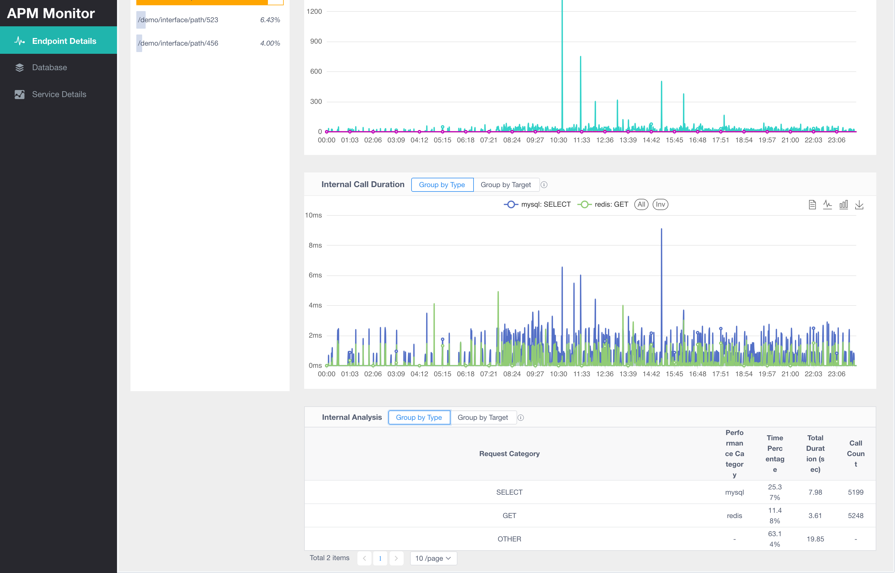
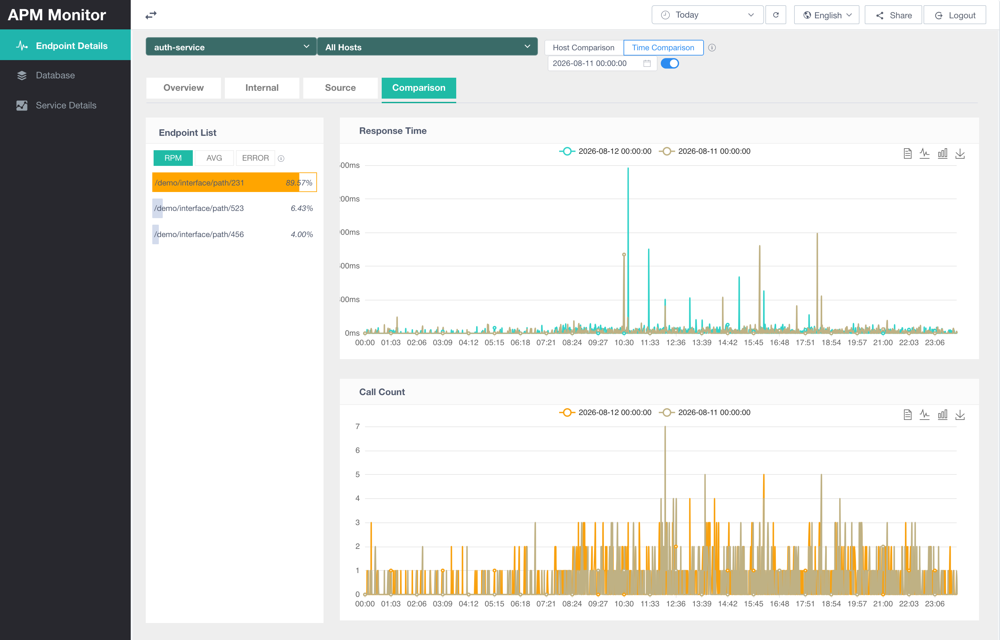
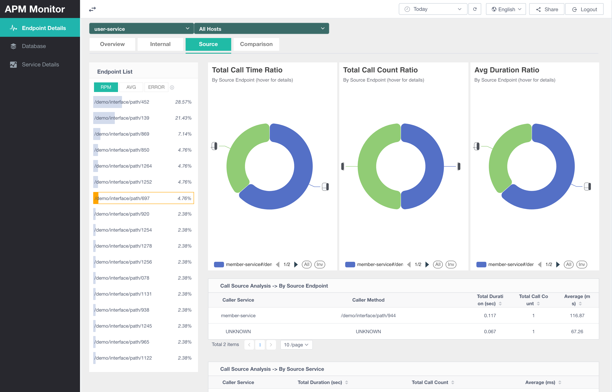
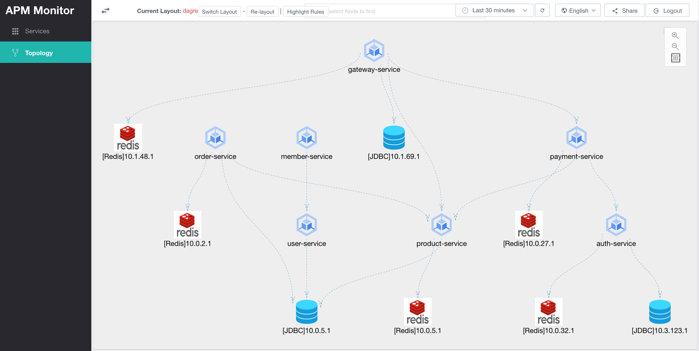
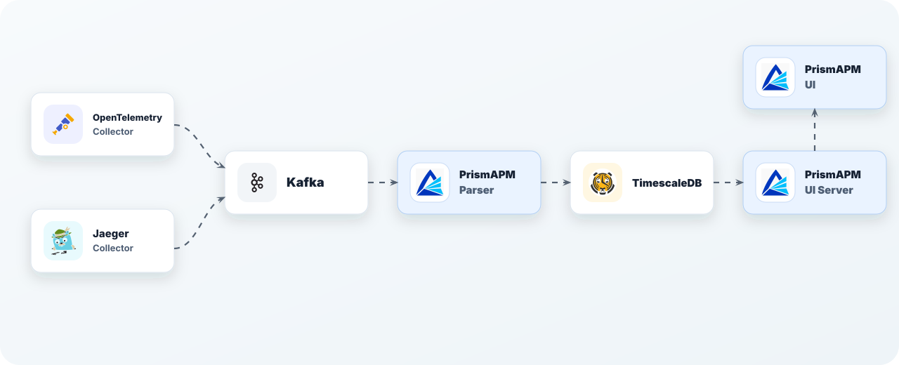

# Prism APM

[English](README.md) | [简体中文](README.zh-CN.md)

Prism APM is a distributed application performance monitoring system based on OpenTelemetry Trace data.

It helps you investigate service latency, endpoint behavior, internal application calls, upstream and downstream dependencies, and service topology. The goal is not only to show call information, but also to provide useful evidence when you are diagnosing complex production problems.

## What It Can Do

- View service, endpoint, database, Redis, Kafka, and other call information.
- Inspect internal calls inside an endpoint.
- Compare RED metrics by time range or host.
- Analyze upstream and downstream service dependencies.
- View service topology.
- Use fine-grained dimensions such as component, action, host, and remote address.

## Highlights

### Inspect Internal Application Calls

When endpoint latency increases, you often need to know what made the endpoint slow: database calls, Redis calls, remote service calls, or other internal work. Prism APM lets you inspect internal endpoint calls, including duration and percentage of total duration.



### Compare Metrics

When a problem occurs, you can compare concrete metrics. Endpoints can be compared by time range or by host, making it easier to locate whether a problem is time-related, instance-related, or service-related.



### Analyze Upstream and Downstream Data

For an endpoint, Prism APM can provide both upstream and downstream call data.

- Upstream: which services called the endpoint, and how many times.
- Downstream: which services the endpoint called.



### View Service Topology

Use the topology graph to understand service architecture and service call relationships.



## Fine-Grained Metrics

In addition to endpoint names and counts, Prism APM records other useful fields. You can inspect these fields to determine whether a problem is related to a component, a component version, a host, or another dimension.

Examples of stored dimensions include:

- `system_type`: `http`, `kafka`, `redis`, `postgresql`
- `component`: `io.opentelemetry.jdbc`, `io.opentelemetry.apache-httpclient-2.0`, `io.opentelemetry.apache-httpclient-4.0`
- `action_name`: `PUT`, `POST`, `SETEX`, `BATCH INSERT`
- `host_name`: `your-server-prod-o-59595cdc5f-hkhz9`
- `remote_addr`: `11.73.52.114`, `${public_ip}`

## Architecture

Prism APM includes data parsing, storage aggregation, query APIs, and frontend visualization.



| Module | Description |
| --- | --- |
| `prism-apm-common` | Common backend entities, Mappers, utilities, and test helpers. |
| `prism-apm-parser` | Consumes Trace data from Kafka, parses it, and writes it to PostgreSQL/TimescaleDB. |
| `prism-apm-ui-server` | Query APIs and permission-related backend services. |
| `prism-apm-ui` | Frontend pages. |
| `prism-explorer` | Demo and local exploration environment. |

See the [architecture documentation](docs/en/architecture/architecture.md) for more details.

## Quick Start

The easiest way to try Prism APM is to run the `prism-explorer` demo environment.

- [Quickstart](docs/en/getting-started.md)

## Quick Build

```bash
./mvnw -pl prism-apm-common clean install -DskipTests
./mvnw -pl prism-apm-parser clean package -DskipTests
./mvnw -pl prism-apm-ui-server clean package -DskipTests

cd prism-apm-ui
npm install
npm run build
```

For complete deployment steps, see the [Deployment Guide](docs/en/deployment.md).

## Documentation

- [Introduction](docs/en/introduction.md)
- [Getting Started](docs/en/getting-started.md)
- Features
  - [Service Metrics](docs/en/features/service-metrics_feature.md)
  - [Topology](docs/en/features/topology_feature.md)
  - [Parser](docs/en/features/parser_feature.md)
  - [Admin](docs/en/features/admin_feature.md)
- [Architecture](docs/en/architecture/architecture.md)
- [Configuration](docs/en/configuration/parser_configuration.md)
- [Deployment](docs/en/deployment.md)
- [Development](docs/en/development.md)
- [FAQ](docs/en/faq.md)

## Limitations

The current system is not suitable for analyzing very long calls that exceed the system wait time or continuous aggregate window. Very long durations may not be accurately shown in all aggregate views.

For example, minute-level aggregation covers data from the current time back to the previous 10 minutes. If data generated at `14:00:00` runs for 15 minutes and is processed at `14:15:00`, that record will not be aggregated. You can adjust the minute-level aggregation window, but the 5-minute, hourly, and daily aggregation windows may also need corresponding adjustments.

## License

Prism APM is licensed under the Apache License, Version 2.0. See [LICENSE](LICENSE) for details.
