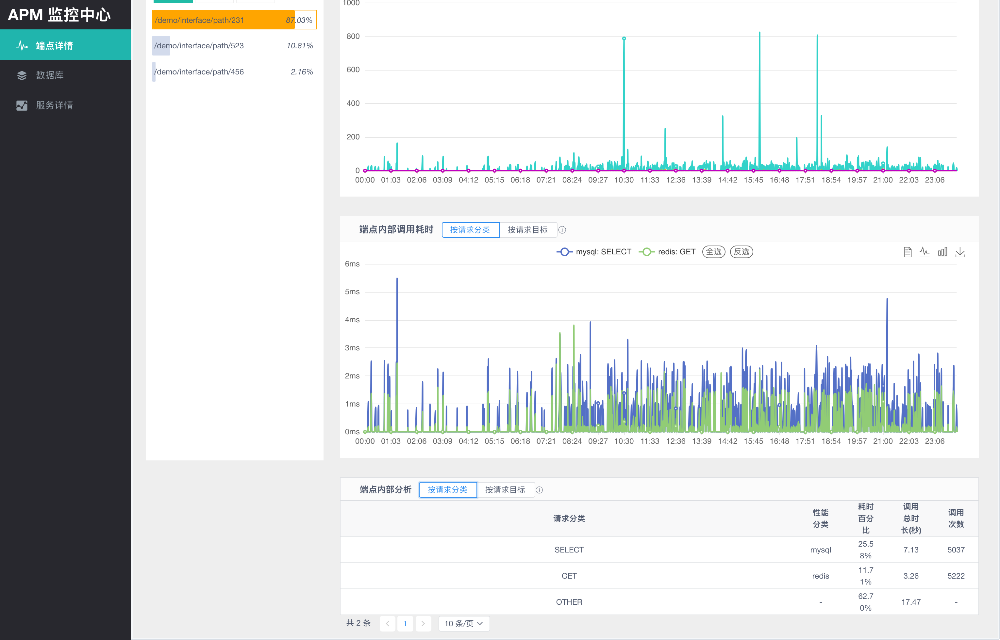
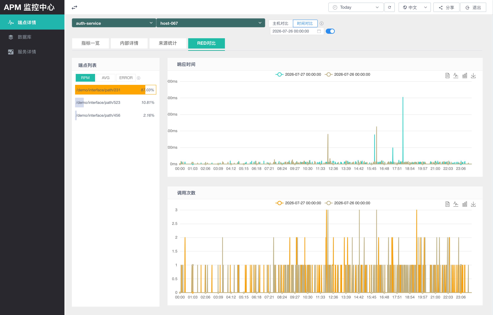
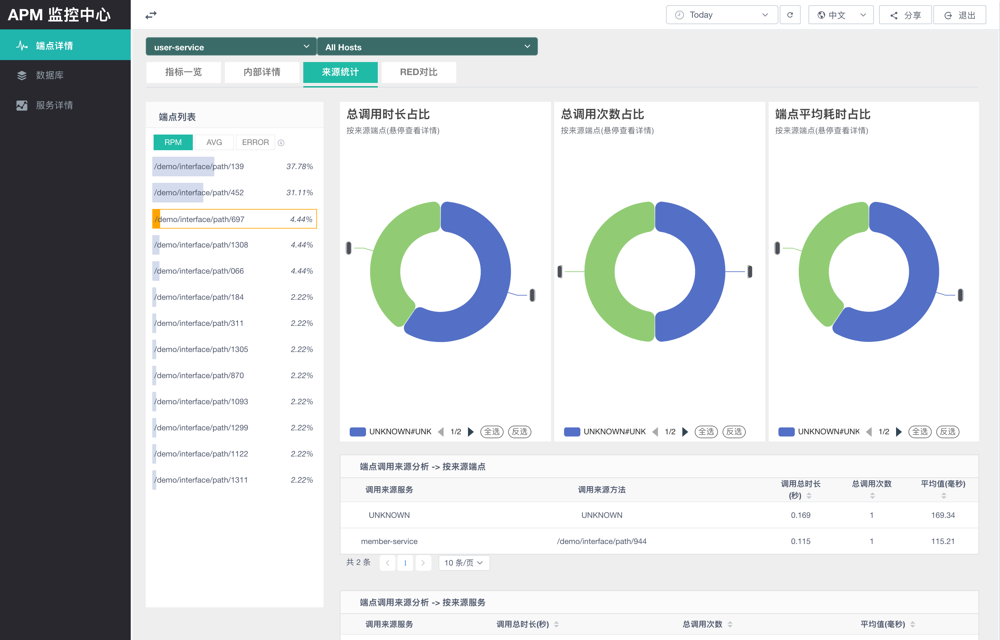

# Prism APM

[English](README.md) | [简体中文](README.zh-CN.md)

Prism APM 是一个基于 OpenTelemetry Trace 数据的分布式应用性能监控系统。

它可以帮助你分析服务延迟、Endpoint 行为、应用内部调用、上下游依赖关系以及服务拓扑。Prism APM 的目标不只是展示调用信息，也希望在排查复杂生产问题时提供有价值的证据。

## 它能做什么

- 查看服务、Endpoint、数据库、Redis、Kafka 等调用信息。
- 查看一个 Endpoint 内部的调用明细。
- 按时间范围或主机对比 RED 指标。
- 分析服务的上游和下游依赖关系。
- 查看服务拓扑图。
- 使用组件、操作、主机、远程地址等细粒度维度分析问题。

## 功能亮点

### 查看应用内部调用

当 Endpoint 延迟升高时，你通常需要知道到底是什么让它变慢：数据库调用、Redis 调用、远程服务调用，还是其它内部逻辑。Prism APM 可以展示 Endpoint 内部调用情况，包括耗时和耗时占比。



### 指标对比

当问题发生时，你可以对具体指标进行对比。Endpoint 支持按时间范围或主机维度进行对比，方便判断问题是否与时间、实例或服务相关。



### 分析上下游数据

对于一个 Endpoint，Prism APM 可以提供上游和下游调用数据。

- 上游：哪些服务调用了这个 Endpoint，以及调用次数。
- 下游：这个 Endpoint 调用了哪些服务。



### 查看服务拓扑

你可以通过拓扑图了解服务架构和服务之间的调用关系。


## 细粒度指标

除了 Endpoint 名称和调用次数，Prism APM 还会记录其它有用字段。你可以根据这些字段进一步判断问题是否与组件、组件版本、主机或其它维度有关。

一些已存储的维度示例：

- `system_type`: `http`, `kafka`, `redis`, `postgresql`
- `component`: `io.opentelemetry.jdbc`, `io.opentelemetry.apache-httpclient-2.0`, `io.opentelemetry.apache-httpclient-4.0`
- `action_name`: `PUT`, `POST`, `SETEX`, `BATCH INSERT`
- `host_name`: `your-server-prod-o-59595cdc5f-hkhz9`
- `remote_addr`: `11.73.52.114`, `${public_ip}`

## 系统架构

Prism APM 包含数据解析、存储聚合、查询 API 和前端可视化。


| 模块 | 说明 |
| --- | --- |
| `prism-apm-common` | 后端通用实体、Mapper、工具类和测试辅助代码。 |
| `prism-apm-parser` | 从 Kafka 消费 Trace 数据，解析后写入 PostgreSQL/TimescaleDB。 |
| `prism-apm-ui-server` | 查询 API 和权限相关的后端服务。 |
| `prism-apm-ui` | 前端页面。 |
| `prism-explorer` | 演示和本地体验环境。 |

更多内容请查看 [架构文档](docs/zh-CN/architecture/architecture.md)。

## 快速开始

体验 Prism APM 最简单的方式是运行 `prism-explorer` 演示环境。

- [快速开始](docs/zh-CN/getting-started.md)

## 快速构建

```bash
./mvnw -pl prism-apm-common clean install -DskipTests
./mvnw -pl prism-apm-parser clean package -DskipTests
./mvnw -pl prism-apm-ui-server clean package -DskipTests

cd prism-apm-ui
npm install
npm run build
```

完整部署步骤请查看 [部署指南](docs/zh-CN/deployment.md)。

## 文档

- [项目介绍](docs/zh-CN/introduction.md)
- [快速开始](docs/zh-CN/getting-started.md)
- 功能
  - [服务指标](docs/zh-CN/features/service-metrics_feature.md)
  - [拓扑图](docs/zh-CN/features/topology_feature.md)
  - [Parser](docs/zh-CN/features/parser_feature.md)
  - [Admin](docs/zh-CN/features/admin_feature.md)
- [系统架构](docs/zh-CN/architecture/architecture.md)
- [配置说明](docs/zh-CN/configuration/parser_configuration.md)
- [部署指南](docs/zh-CN/deployment.md)
- [开发指南](docs/zh-CN/development.md)
- [FAQ](docs/zh-CN/faq.md)

## 限制

当前系统不适合分析超过系统等待时间或连续聚合窗口的超长调用。过长的 duration 可能无法在所有聚合视图中准确展示。

例如，分钟级聚合会覆盖从当前时间往前 10 分钟的数据。如果 `14:00:00` 产生的数据执行了 15 分钟，到 `14:15:00` 才被处理，那么这条数据不会被聚合。你可以调整分钟级数据的聚合窗口，但 5 分钟、小时、天级数据的聚合窗口可能也需要相应调整。

## License

Prism APM 使用 Apache License, Version 2.0。详情请查看 [LICENSE](LICENSE)。
