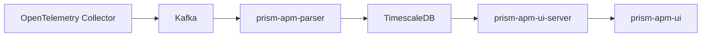
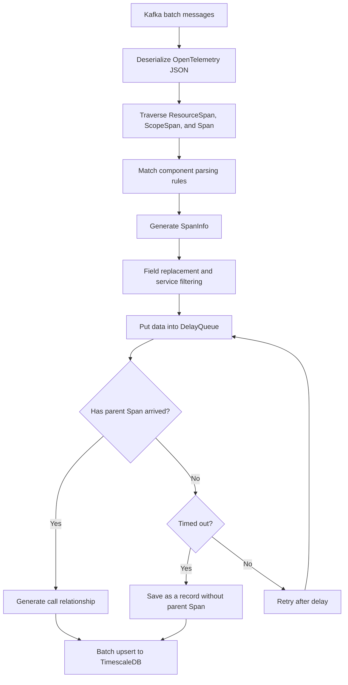
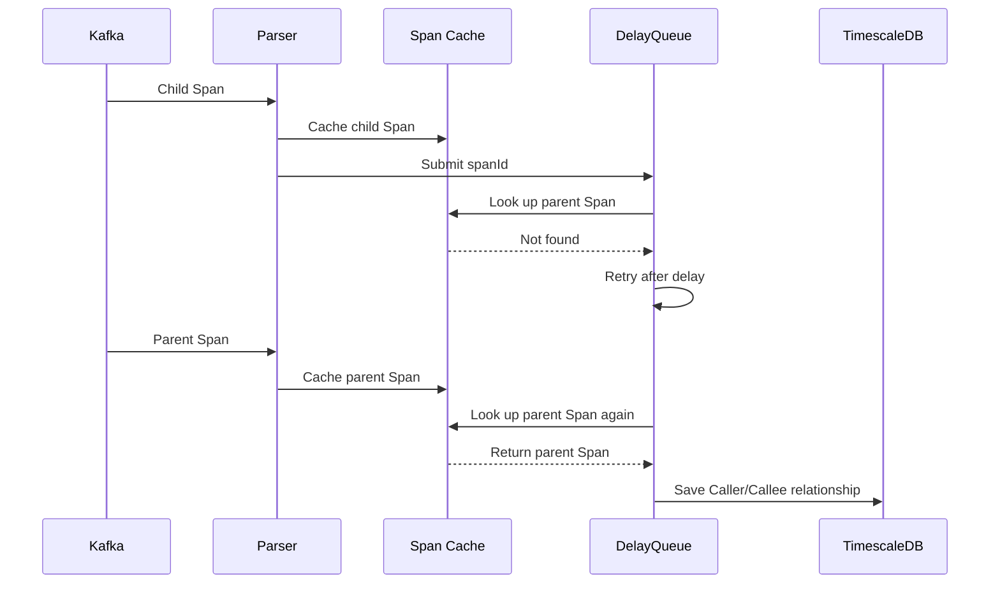

`prism-apm-parser` consumes, parses, and stores Trace data. It is the data ingestion side of Prism APM.

# Responsibilities

Parser is responsible for:

- Consuming OpenTelemetry Trace JSON from Kafka in batches.
- Converting Spans into a unified internal model.
- Extracting fields such as service, endpoint, component, and target resource according to rules.
- Correlating parent and child Spans to generate service call relationships.
- Writing results to TimescaleDB in batches.
- Supporting data reprocessing for a specified time range.

Parser is not responsible for:

- Directly receiving OTLP HTTP or OTLP gRPC data.
- Storing or querying complete raw Traces.

Currently, only the OpenTelemetry JSON parser is implemented.

# Architecture Position



Parser and UI Server are decoupled through the database:

- Parser writes data.
- UI Server queries data.

# Input and Output

## Input

Parser consumes data from these Kafka topics:

| Configuration | Default | Purpose |
| --- | --- | --- |
| `parser.kafka_topic` | `opentelemetry-trace` | Receives normal Trace data. |
| `parser.reprocessing_kafka_topic` | `reprocessing-opentelemetry-trace` | Receives reprocessing data. |

Each Kafka message should be an OpenTelemetry Trace JSON with this main structure:

```text
resourceSpans
  -> scopeSpans
    -> spans
```

Parser does not receive OTLP Protobuf. Collector must first convert data to the JSON format supported by Parser and then send it to Kafka.

Production recommendations:

- Use `traceId` as the Kafka message key.
- Let Collector choose the Kafka partition by `traceId`.
- Ensure the Kafka topic partition count is no smaller than Parser consumer concurrency.
- Use consistent message-size limits across Collector, Kafka Broker, and Kafka Consumer.

**Spans from the same Trace should enter the same partition.** This is an important prerequisite for correlating parent and child Spans inside the same Parser instance.

## Output

Parser mainly writes these database objects:

| Object | Purpose |
| --- | --- |
| `service_call` | Stores normalized service call records. |
| `resource_hash_dictionary` | Stores mappings from target resource names to hashes. This mainly reduces data storage pressure. |

Database structures are defined in:

- `sql/10_create_service_call_objects.sql`
- `sql/11_create_app_config_objects.sql`

# Processing Flow



# Internal Data Model

Parser uses `SpanInfo` as the unified Span model.

| Field | Meaning |
| --- | --- |
| `traceId` | Trace identifier. |
| `spanId` | Span identifier. |
| `parentSpanId` | Parent Span identifier. |
| `serviceName` | Service name. |
| `hostName` | Host name. |
| `actionName` | Endpoint or operation name. |
| `targetName` | Called endpoint, database statement, or message target. |
| `systemType` | System type, such as `http`, `redis`, or `postgresql`. |
| `component` | OpenTelemetry Instrumentation Scope name. |
| `spanKind` | Span kind. |
| `remoteAddr` | Caller or target address. |
| `duration` | Span duration in microseconds. |
| `error` | Error flag. |
| `time` | Span start time in Unix microseconds. |

When writing `service_call`, each record contains the main fields of both the current Span and the caller. UI Server uses these fields to query:

- Service and endpoint metrics.
- Internal application calls.
- Upstream and downstream relationships.
- Service topology.

# Parent-Child Span Correlation

Span arrival order in Kafka is unreliable. Child Spans may arrive before parent Spans, so Parser uses local cache and DelayQueue to wait for parent Spans.



Related parameters:

| Configuration | Default | Description |
| --- | --- | --- |
| `cache.timeout_s` | `600` | How long a Span remains in local cache, in seconds. |
| `dependency.timeoutThreshold` | `60000` | Maximum wait time for the parent Span, in milliseconds. |
| `delayMillis` | `3000` | Retry interval when the parent Span has not been found, in milliseconds. |
| `delay.component.local.thread_num` | `4` | DelayQueue consumer thread count. |
| `delay.component.local.batch_size` | `10` | Maximum Spans processed each time. |
| `delay.component.local.batch_timeout_ms` | `1000` | Maximum wait time for assembling a batch. |

The following condition should preferably be satisfied; otherwise parent Span information may be evicted from local cache before waiting finishes.

```text
cache.timeout_s × 1000 > dependency.timeoutThreshold
```

Longer `dependency.timeoutThreshold` means:

- More complete parent-child relationships.
- Higher local cache usage.
- Greater data write latency.
- TimescaleDB continuous aggregates need to cover a longer late-data window.

Shorter `dependency.timeoutThreshold` means:

- More timely writes.
- Fewer waiting Spans and lower resource usage.
- The parent Span may time out before it arrives.
- More Spans are saved without parent Span information, so service call chains, upstream/downstream relationships, and topology may be incomplete.

# Reprocessing

**This feature is not yet production-ready**, for these reasons:

- After data is read from Kafka and parsed into individual Spans, sending it back to Kafka is very slow.
- A large amount of manual reaggregation is needed for related tables.

Parser provides data reprocessing APIs for reconsuming Kafka data in a specified time range.

| API | Purpose |
| --- | --- |
| `GET /reprocessing/quick/{timeInterval}` | Reprocesses a recent time interval, such as `6m` or `1d`. |
| `GET /reprocessing/consume` | Specifies Kafka start time and Span time range. |
| `GET /reprocessing/transferData` | Refreshes continuous aggregates for a specified time range. |

The default port is `8090`.

## `/reprocessing/quick/{timeInterval}`

Quickly reprocess data from a recent time interval.

```bash
curl -X GET "http://localhost:8090/reprocessing/quick/6m"
```

`timeInterval` format:

| Format | Meaning |
| --- | --- |
| `6m` | Last 6 minutes. |
| `1d` | Last 1 day. |

Currently supported suffixes:

- `m`: minutes.
- `d`: days.

This API automatically calculates:

- `startTime = current UTC time - timeInterval`
- `endTime = current UTC time`
- `kafkaStartTime = startTime`

It is suitable for temporarily filling a small recent data gap.

## `/reprocessing/consume`

Reconsume data from the raw Trace topic by time and send it to the reprocessing topic.

```bash
curl -X GET "http://localhost:8090/reprocessing/consume?kafkaStartTime=2026-06-30T08:00:00Z&spanStartTime=2026-06-30T08:00:00Z&spanEndTime=2026-06-30T09:00:00Z"
```

Parameters:

| Parameter | Format | Meaning |
| --- | --- | --- |
| `kafkaStartTime` | `Instant`, for example `2026-06-30T08:00:00Z` | Kafka offset start time. |
| `spanStartTime` | `Instant`, for example `2026-06-30T08:00:00Z` | Only process Spans whose start time is greater than or equal to this value. |
| `spanEndTime` | `Instant`, for example `2026-06-30T09:00:00Z` | Only process Spans whose start time is less than this value. |

Time relationships must satisfy:

```text
kafkaStartTime <= spanEndTime
spanStartTime <= spanEndTime
```

Usually, `kafkaStartTime` can equal `spanStartTime`. If Kafka message write time and Span start time may differ, move `kafkaStartTime` earlier as needed.

Processing logic:

1. Find the offset for each Kafka partition according to `kafkaStartTime`.
2. Consume the raw topic from those offsets.
3. Parse each Trace and use the first Span's start time for filtering.
4. Keep only data in `[spanStartTime, spanEndTime)`.
5. Send it to the reprocessing topic using `traceId` as the key.
6. The reprocessing consumer parses it again and writes it to the database.

# Concurrency and Scaling

Parser's final data is stored in TimescaleDB, but processing contains local state:

- Ehcache Span cache.
- In-process DelayQueue.

Therefore Parser is not a fully stateless service. Each restart and scale operation can cause these issues:

- Restarting the service loses Spans in DelayQueue that have not been consumed.
- Scaling out or in may send the same `traceId` to different partitions, causing a small number of service-to-service call relationships to be incomplete.

Throughput is mainly affected by:

- Kafka partition count.
- Kafka consumer concurrency.
- DelayQueue consumer thread count.
- Batch write size.
- Database connection pool size.
- TimescaleDB write capacity.

# Reliability

The current processing chain is not end-to-end transactional.

Kafka offsets are acknowledged after messages are parsed and enter local cache and DelayQueue; acknowledgment does not wait for database writes to succeed. The following situations can cause data loss:

- Offset has been acknowledged, but Parser exits before database writes.
- Database write failure.
- Data in local cache or DelayQueue is lost when the process exits.
- Spans expire or are evicted from cache.

# Logs

Parser writes logs by purpose:

| File | Content |
| --- | --- |
| `server.log` | Main application log. |
| `stats.log` | Consumption, save, and timeout statistics. |
| `cache.log` | Cache expiration and eviction records. |
| `unparsed_span.log` | Spans that cannot be parsed normally. |
| `unparsed_service.log` | Services not participating in parsing. |
| `reprocessing.log` | Data reprocessing logs. |

## `stats.log`

`stats.log` is written periodically by `StatsScheduler`, once per minute by default.

Each output contains these categories:

```text
outputStats started
ehcache stats. exists:..., puts:..., gets:..., removals:..., hits:..., misses:..., Evictions:..., Expirations:..., OccupiedByteSize:...
delay queue size:...,reprocessing delay queue size:...
span stats. saved span: ..., timeout span: ...
outputStats end
```

### Ehcache Statistics

```text
ehcache stats. exists:10, puts:100, gets:80, removals:5, hits:70, misses:10, Evictions:0, Expirations:2, OccupiedByteSize:20480,
```

Fields:

| Field | Meaning |
| --- | --- |
| `exists` | Current number of records in Span Cache. |
| `puts` | Accumulated writes to cache. |
| `gets` | Accumulated cache reads. |
| `removals` | Accumulated removals from cache. |
| `hits` | Accumulated cache read hits. |
| `misses` | Accumulated cache read misses. |
| `Evictions` | Accumulated evictions due to capacity limits. |
| `Expirations` | Accumulated expirations due to timeout. |
| `OccupiedByteSize` | Current cache size in bytes. |

Focus on:

- `exists` keeps rising: many Spans may be waiting for parent Spans.
- `Evictions` keeps increasing: cache capacity may be insufficient.
- `Expirations` keeps increasing: Spans wait too long in cache and parent-child correlation may be affected.
- `misses` is much higher than `hits`: parent Spans are often not found, possibly due to out-of-order Span arrival, unreasonable Kafka partitioning, or too short a wait time.

### DelayQueue Statistics

```text
delay queue size:12,reprocessing delay queue size:0
```

Fields:

| Field | Meaning |
| --- | --- |
| `delay queue size` | Number of Spans waiting in the normal consumption path. |
| `reprocessing delay queue size` | Number of Spans waiting in the reprocessing path. |

### Span Statistics

```text
span stats. saved span: 1000, timeout span: 20
```

Fields:

| Field | Meaning |
| --- | --- |
| `saved span` | Accumulated number of call records written to the database. |
| `timeout span` | Accumulated number of records saved after waiting for parent Span timed out. |
