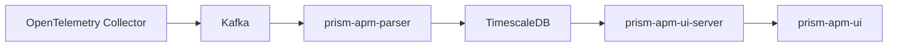
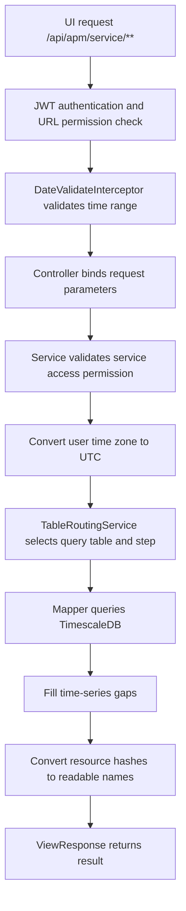

`prism-apm-ui-server` is Prism APM's data query and management backend. It reads call data and aggregate data written by Parser to TimescaleDB and converts them into service metrics, endpoint analysis, dependency topology, and management data required by the frontend.

# Responsibilities

UI Server is responsible for:

- Providing query APIs for services, endpoints, database access, upstream/downstream dependencies, and similar data.
- Selecting aggregate tables at different granularities according to the query time span.
- Converting user-entered local time to UTC before querying the database.
- Filling gaps in time series and converting resource hashes back to readable names.
- Generating topology for services, databases, Redis, and message queues from call relationships.
- Providing access control based on JWT, roles, permissions, and project groups.
- Providing management APIs for users, roles, permissions, projects, and project groups.
- Managing topology alert rules and returning nodes and edges that should be highlighted.

UI Server is not responsible for:

- Receiving, parsing, or storing OpenTelemetry Trace data. That is the responsibility of [Parser](parser_architecture.md).
- Storing or querying complete raw Traces.
- Hosting frontend static assets. In production, deploy `prism-apm-ui` separately and proxy `/api` to UI Server.
- Generating TimescaleDB continuous aggregates. Aggregate objects are created and maintained by database scripts under `sql/`.

# Architecture Position



Parser and UI Server are decoupled through the database:

- Parser is the data write side and normalizes Spans into call records.
- TimescaleDB stores raw call records, continuous aggregates, permission configuration, and query routing rules.
- UI Server is the data read side and is responsible for permission filtering, query orchestration, and view-model conversion.
- UI only depends on UI Server HTTP APIs and does not access the database directly.

UI Server is stateless. JWT does not store server-side sessions, and multiple instances can share the same database and JWT secret for horizontal scaling.

# Internal Structure

UI Server is implemented with Java 21, Spring Boot 3, Spring Security, MyBatis-Plus, and the PostgreSQL driver.

```text
org.prism.apm.ui.server
├── config          Spring MVC, Spring Security, MyBatis, and similar configuration
├── controller      Query, topology, and admin APIs
├── entity          Request parameters, database objects, DTOs, and response models
├── exceptions      Business exceptions and global exception handling
├── interceptor     Time-range parameter validation
├── mapper          MyBatis Mapper interfaces
├── route           Dynamic query table routing
├── schedule        Scheduled jobs such as data prewarm
├── security        JWT authentication and dynamic URL authorization
├── service         Query orchestration, topology calculation, and admin management
└── utils           Timeline, gap filling, parameter validation, and similar utilities
```

Layer boundaries:

| Layer | Purpose |
| --- | --- |
| `controller` | Receives HTTP parameters, calls Service, and wraps unified responses. Controllers do not execute SQL directly. |
| `service` | Performs business validation, permission filtering, table routing, query composition, and result conversion. |
| `mapper` | Executes PostgreSQL/TimescaleDB queries through Mapper interfaces and XML. |
| `route` | Selects target tables and time steps based on query span and data type. |
| `security` | Restores identity from JWT and authorizes requests according to URL permission rules in the database. |

# Query Flow

Using a service metrics query as an example, one request goes through these steps:



## Time Parameters

Metric queries usually accept these parameters:

| Parameter | Format | Description |
| --- | --- | --- |
| `startDate` | `yyyy-MM-dd HH:mm:ss` | Start time in the user's time zone. |
| `endDate` | `yyyy-MM-dd HH:mm:ss` | End time in the user's time zone. |
| `timezone` | IANA Zone ID | For example `Asia/Shanghai`; used to handle time-zone offset and daylight saving time. |

`DateValidateInterceptor` currently applies to `/api/apm/common/**` and `/api/apm/service/**`:

- `startDate` and `endDate` must be provided together.
- Query span must be at least 1 minute.
- Query span cannot exceed 360 days.
- GET requests under these paths must provide `timezone`. In the current implementation, this check runs even if the API itself does not use time parameters.

Topology queries do not go through this interceptor. The Controller converts `DateParam` to UTC. When adding a new time-range API, explicitly add the path to the interceptor or perform equivalent validation in Service.

Service converts local time to UTC, and SQL filters data using UTC time. Returned results are converted into a complete timeline according to the routing step. Missing time buckets are filled with default values to avoid chart breaks or misalignment.

## Dynamic Table Routing

The same category of data is stored at minute, 5-minute, hourly, or daily granularities. Short-range queries need fine-grained data, while long-range queries are better served by aggregate tables. `TableRoutingService` selects query tables from `table_routing_rules` according to query span, avoiding hard-coded table names in every Service.

Current routing tags include:

| Tag | Purpose |
| --- | --- |
| `entry` | Service entry and endpoint metrics. |
| `dependency` | Downstream dependency, database, and internal call metrics. |
| `topology` | Service and middleware topology relationships. |
| `hostname` | Service instance list within a specified time range. |

Each rule contains a time-span interval, target table, data step, and rule type:

- `SIMPLE`: use `target_table` directly.
- `COMPLEX`: calculate a safe Chunk boundary first. Use `optimized_table` when historical Chunks have been optimized; otherwise use `target_table`.
- `data_step`: result time granularity in minutes, such as `1`, `5`, `60`, or `1440`.

At application startup, `TableRoutingStore` loads rules from the database and checks each tag for gaps, overlaps, or incorrectly placed infinite intervals. Invalid rules cause startup failure, preventing queries from silently choosing the wrong table at runtime.

# Core Capabilities

## Service and Endpoint Analysis

`/api/apm/service/**` provides these query capabilities:

| Capability | Description |
| --- | --- |
| Service overview | Queries service-level request volume, errors, duration, and similar metrics. |
| Service details | Views service metrics along a timeline, with optional host filtering. |
| Endpoint list | Queries service entry endpoints and their metrics. |
| Endpoint details | Compares RED metrics for entry endpoints and internal calls. |
| Internal call graph | Analyzes interfaces and resources accessed inside one entry endpoint. |
| Upstream analysis | Aggregates \"who is calling me\" by endpoint or service. |
| Database analysis | Queries lists and detailed metrics for database and other dependencies. |

Metric queries mainly read `service_call` data produced by Parser and its TimescaleDB continuous aggregates. `resource_hash_dictionary` converts compressed resource hashes back to endpoint, SQL, or message target names.

## Common Queries

`/api/apm/common/**` provides service lists, host lists, and chart timelines.

The service list is not an unconditional set of all services in the database:

- Administrators can access all projects.
- Ordinary users can only access projects associated with their project groups.
- When querying a specific service, the Service layer validates again that the service is in the current user's accessible set.

The project `name` is associated with the service name in APM data, so project configuration directly controls which service data ordinary users can view.

## Service Topology

`/api/apm/topology/topology-data/getData` returns `nodes`, `edges`, and `highlights`:

- RPC calls generate service-to-service edges.
- JDBC and Redis calls generate edges from services to external resources.
- Kafka and RocketMQ data generate edges among producers, message targets, and consumers.
- Duplicate edges are deduplicated by `source::target`.
- Services inaccessible to the current user are not used as topology query entries.

Topology alert rules can find abnormal services according to metric thresholds and calculate influence ratios for upstream/downstream edges so the frontend can highlight nodes and edges. Rule create, update, delete, enable, and disable operations are provided by `/api/apm/topology/topology-warning-rules/**`.

## Admin Management

`/api/admin/**` provides these management capabilities:

- Create, read, update, and delete users, roles, and permissions.
- Create, read, update, and delete projects and project groups.
- Assignment relationships between users and roles, and between roles and permissions.
- Assignment relationships between users and project groups, and between project groups and projects.

Write operations use the `master` datasource and start transactions in the Service layer. Normal queries use the `slave` datasource by default. In a single-database deployment, read and write datasources can point to the same PostgreSQL/TimescaleDB instance.

# Authentication and Authorization

UI Server uses stateless JWT authentication:

1. The client submits username and password to `/api/apm/login`.
2. After login succeeds, the server returns a signed JWT.
3. Later requests send the JWT through `Authorization: Bearer <token>`.
4. `JwtAuthenticationFilter` validates the signature and expiration time, then loads user roles from the database.
5. `CustomAuthorizationManager` decides whether to allow the request according to request URL and roles.

The authorization model has two layers:

| Layer | Protected object | Implementation |
| --- | --- | --- |
| API permission | Whether a role can access a URL | URL patterns in the permission table and role-permission relationships. |
| Data permission | Whether a user can view a service | Relationships among users, project groups, and projects. |

`ROLE_ADMIN` has API super-permission and can view all projects. Other users must match URL permission rules from the database. Unconfigured URLs are denied by default. Permission rules are loaded into memory at application startup and refreshed every 60 seconds, so permission changes can take up to about 60 seconds to take effect on all instances.

> The current password encoder is `NoOpPasswordEncoder`. It is only suitable for controlled development environments. Before public deployment, replace it with BCrypt or another adaptive one-way password hash and migrate existing passwords.

# API Conventions

All `@RestController` endpoints automatically receive the `/api` prefix. Main API groups:

| Path | Description |
| --- | --- |
| `/api/apm/login` | Login and obtain JWT. |
| `/api/apm/logout` | Client logout. The server has no Session; the client should also delete the JWT. |
| `/api/apm/common/**` | Common queries such as services, machines, and timelines. |
| `/api/apm/service/**` | Service, endpoint, dependency, and database metric queries. |
| `/api/apm/topology/**` | Topology data and topology alert rules. |
| `/api/admin/**` | User, role, permission, project, and relationship management. |

Normal business APIs use a unified response:

```json
{
  "status": 200,
  "msg": "OK",
  "data": {}
}
```

Pagination APIs additionally return `total`. Business exceptions are converted to failure responses by `GlobalExceptionHandler`. Unhandled exceptions only return \"internal server error\" to the client, with detailed stack traces written to server logs.

This document only describes API groups and architecture conventions. Parameters, response fields, and examples should be maintained in separate API documentation to avoid coupling API changes with architecture descriptions.

# Datasources and Configuration

Main configuration is located at:

```text
prism-apm-ui-server/src/main/resources/application.properties
```

| Environment variable | Required | Description |
| --- | --- | --- |
| `DB_WRITE_ENDPOINT` | Yes | Write database endpoint, in `host:port` format. |
| `DB_WRITE_DB_NAME` | Yes | Write database name. |
| `DB_WRITE_USERNAME` | Yes | Write database username. |
| `DB_WRITE_PASSWORD` | Yes | Write database password. |
| `DB_READ_ENDPOINT` | Yes | Read database endpoint, in `host:port` format. |
| `DB_READ_DB_NAME` | Yes | Read database name. |
| `DB_READ_USERNAME` | Yes | Read database username. |
| `DB_READ_PASSWORD` | Yes | Read database password. |
| `JWT_SECRET` | Yes | JWT HMAC secret. HS256 requires at least 32 bytes; the default placeholder cannot be used for real startup. |
| `JWT_EXPIRATION` | No | JWT lifetime in milliseconds, default `86400000`. |

Optional TimescaleDB prewarm jobs are controlled by:

| Configuration | Default | Description |
| --- | --- | --- |
| `apm.schedule.prewarm-enabled` | `false` | Whether to enable prewarming. |
| `apm.schedule.prewarm-function` | `prewarm_data` | Database function to call. |
| `apm.schedule.prewarm-cron` | `* 0/10 * * * ?` | Job Cron expression. |

Database objects and seed data are maintained under `sql/`. For detailed initialization, build, and startup steps, see [Parser configuration](../configuration/parser_configuration.md), [UI Server configuration](../configuration/ui-server_configuration.md), [development](../development.md), and [deployment](../deployment.md).

# Extension Guide

## Add a Metric Query

When adding a new metric query, usually:

1. Define request and response models in `entity/param` and `entity/response`.
2. Add queries to the `mapper` interface and corresponding XML.
3. In `service`, perform parameter validation, service permission validation, UTC conversion, and table routing.
4. Fill time-series results according to `RouteInfo.dataStep`.
5. Expose the endpoint in `controller` and wrap results with `ViewResponse`.
6. Configure role permissions for the new URL in permission initialization data.
7. Add tests for routing boundaries, SQL queries, and permission filtering.

Do not concatenate user-provided table names directly in Mapper XML. Dynamic table names must come from validated `table_routing_rules`; business filter values should use MyBatis parameter binding.

## Add an Aggregate Granularity

A new granularity requires changes in:

- Continuous aggregates or target tables under `sql/`.
- Time intervals and `data_step` for the corresponding tag in `table_routing_rules`.
- Timeline and gap-filling support for the new step.
- Routing-rule and Mapper query tests.

Rules under the same tag must continuously cover all query spans from 0 seconds, without overlaps or gaps.

# Testing Focus

UI Server tests mainly cover:

- Table routing boundaries, gaps, overlaps, and Chunk-safe boundaries.
- Actual SQL for service, target-resource, and database metric Mappers.
- Transaction behavior for users, roles, permissions, projects, and relationships.
- PostgreSQL/TimescaleDB indexes and query-plan checks.

Tests involving Mapper or TimescaleDB-specific behavior should use a real PostgreSQL/TimescaleDB environment, not an in-memory database whose SQL dialect differs from production.
