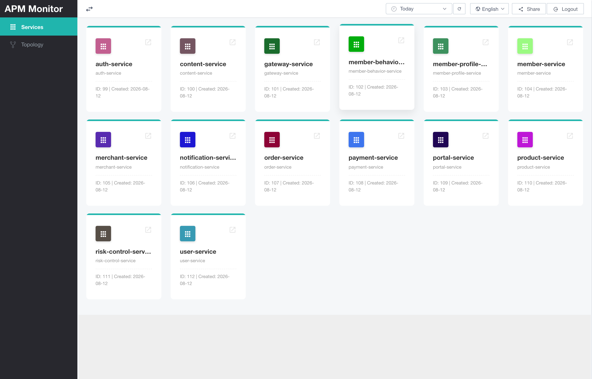
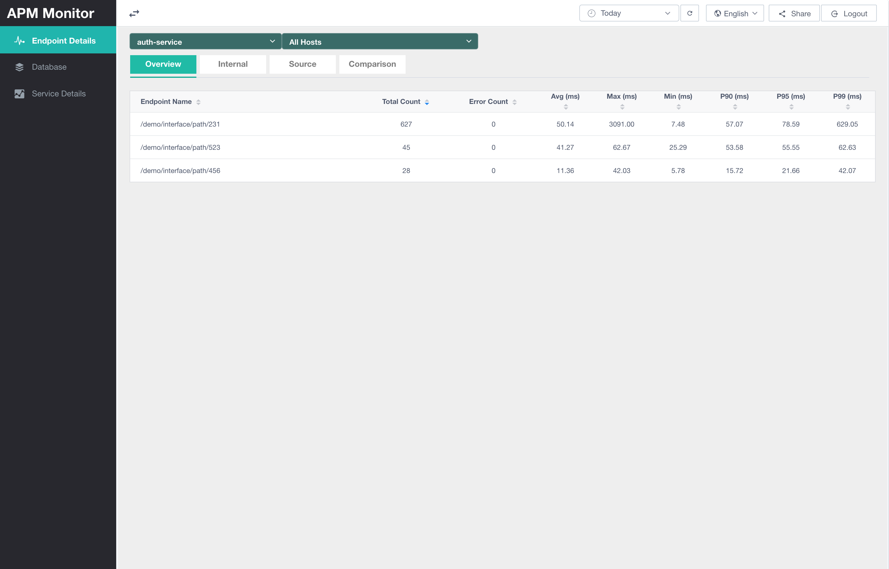
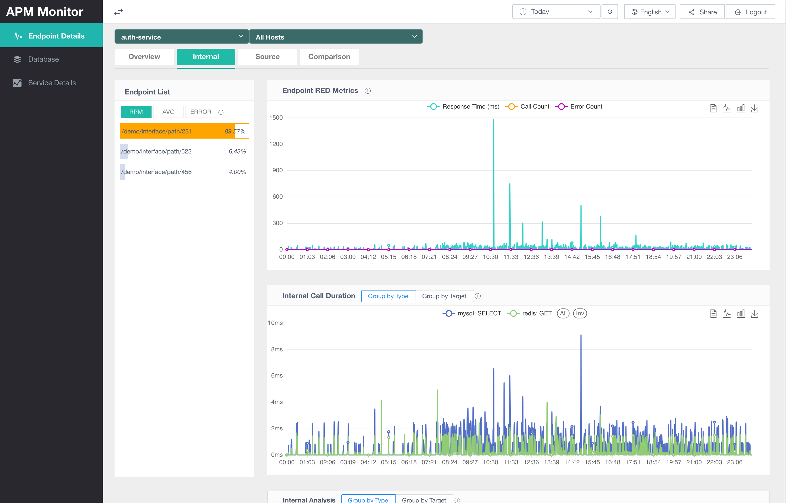
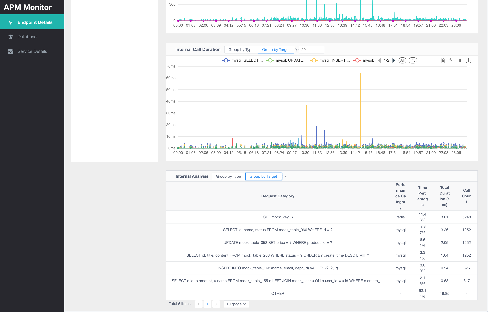
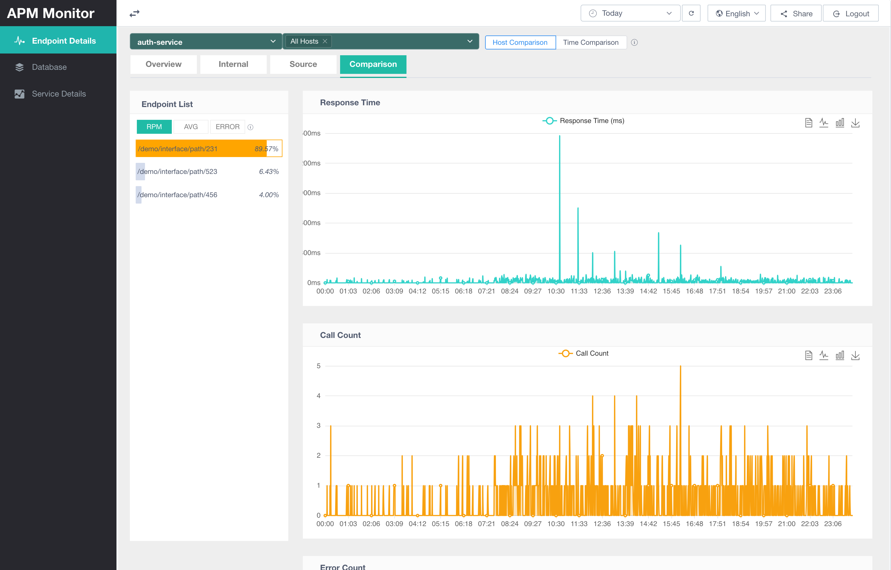
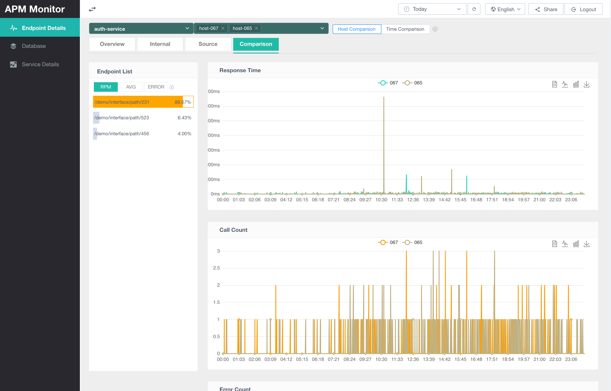

Service metrics are used to view the runtime state of services, endpoints, and dependency calls from APM service-call data. They help operations and development teams quickly determine request volume, response time, error count, slow endpoints, internal dependency duration, and call sources for a service within a selected time range.

The endpoint details page is reached by opening the service overview at `http://localhost:8066/#/overview/application` and selecting a service.

# Feature Description

The service metrics pages start from a service and mainly analyze endpoints. Under the global time range, service, and host filters, the page shows endpoint metrics, RED curves for a single endpoint, internal call breakdowns, source statistics, and RED comparison for the selected service.

Core capabilities include:

- View call count, error count, average duration, max duration, min duration, and P90/P95/P99 durations for all endpoints under a service.
- Enter more detailed analysis from an endpoint and observe RED metrics for a single endpoint over time.
- Break down internal endpoint call duration to identify whether the main cost comes from SQL, HTTP, Redis, MQ, or other internal requests.
- View who called the current endpoint, aggregated by source endpoint and source service.
- Compare the same endpoint by host or by time range, covering response time, call count, and error count changes.

Service metrics are useful for these investigation and analysis scenarios:

- When an endpoint becomes slow, open Internal Details to inspect endpoint RED curves and internal call-duration breakdowns.
- When you need to confirm traffic sources, open Source Statistics to view source endpoints and source services.
- When you need to determine whether a problem only occurs on one host or during one period, open RED Comparison for host comparison or time comparison.
- When the whole service slows down, sort Metric Overview by `Avg (ms)`, `P95 (ms)`, or `P99 (ms)` to find slow endpoints.
- When service traffic spikes, sort by `Total Count` to identify the main traffic entrances.
- When errors occur, sort by `Error Count` to identify the endpoints where errors are concentrated.

# Page Entry and Filters

Select a service card on the service overview page to open that service's endpoint details page.

After entering the page, the common filter area at the top affects all subsequent queries:

| Control | Description |
| --- | --- |
| Time range | Defaults to the last 30 minutes. A custom time range can also be selected. |
| Service selection | The service currently being analyzed. This value is usually carried over from the service overview card click, and can also be switched at the top of the endpoint details page. |
| Host selection | Defaults to `All Hosts`, which queries all hosts of the service. After selecting a single host, the page only shows call metrics from that host. |
| Refresh | Requeries data using the current filters. |
| Language | Switches between Chinese and English UI. |
| Share | Copies the current page URL with service name and time-range parameters, making it easier to share the same analysis view. |

Views related to service metrics in the left navigation include:

| Menu | Description |
| --- | --- |
| Endpoint details | The endpoint metrics, internal details, source statistics, and RED comparison page described in this document. |
| Database | View metrics by database or external dependency dimension. |
| Service details | View service-level metrics over a timeline. |

# Metric Overview

Metric Overview is the default tab on the endpoint details page. It lists endpoint metrics for the current service within the selected time range.

| Field | Meaning |
| --- | --- |
| `Endpoint Name` | Endpoint name or interface path. |
| `Total Count` | Total calls to the endpoint in the current time range. |
| `Error Count` | Error calls to the endpoint in the current time range. |
| `Avg (ms)` | Average response time in milliseconds. |
| `Max (ms)` | Maximum response time in milliseconds. |
| `Min (ms)` | Minimum response time in milliseconds. |
| `P90 (ms)` | 90th percentile response time in milliseconds. |
| `P95 (ms)` | 95th percentile response time in milliseconds. |
| `P99 (ms)` | 99th percentile response time in milliseconds. |

Table columns support sorting. Common usage:

- Sort by `Total Count` descending to view high-traffic endpoints.
- Sort by `Error Count` descending to view endpoints where errors are concentrated.
- Sort by `Avg (ms)`, `P95 (ms)`, or `P99 (ms)` descending to view slow endpoints.

If there is no endpoint data in the current time range, switching to another tab displays a message indicating that there is no data for the selected time range and the time range should be selected again.

# Internal Details

Internal Details analyzes RED metrics for a single endpoint and the duration of calls inside that endpoint.

The Endpoint List on the left is used to select the endpoint to analyze and supports sorting by:

| Sort item | Description |
| --- | --- |
| `RPM` | Sort by endpoint call volume. |
| `AVG` | Sort by endpoint average response time. |
| `ERROR` | Sort by endpoint error count. |

The percentage in the endpoint list indicates the current endpoint metric value as a percentage of the total service endpoint metric value. For example, when sorting by `RPM`, the percentage is the endpoint call count divided by the total endpoint call count for the current service.

The right side contains three sections:

| Area | Description |
| --- | --- |
| Endpoint RED metrics | Shows response time, call count, and error count for the selected endpoint over time. RED is a composite metric, so the chart Y axis is not fixed to a single unit. |
| Internal endpoint call duration | Shows the duration trend of calls inside the endpoint. It can be aggregated by request category or request target. |
| Internal endpoint analysis | Shows internal call aggregation results in a table, including request category, performance category, duration percentage, total call duration, and call count. |

Internal call aggregation modes:

| Aggregation mode | Description |
| --- | --- |
| By request category | Aggregates by internal call category, such as `SELECT`, `GET`, `POST`, or `OTHER`. Useful for quickly determining which type of operation contributes duration. |
| By request target | Aggregates by concrete request target, such as a SQL statement, URL, or external system target. Useful for locating specific slow dependencies. This mode can have many rows; it loads 20 rows by default and the display count can be adjusted with the input box. |

The lower half can switch both Internal Endpoint Call Duration and Internal Endpoint Analysis between request category and request target views.

Internal Endpoint Analysis table fields:

| Field | Meaning |
| --- | --- |
| Request category | Internal call action or aggregation name. |
| Performance category | System type of the internal call, such as `mysql` or `http`. |
| Duration percentage | Percentage of endpoint total duration contributed by this internal call. |
| Total call duration (seconds) | Accumulated duration within the current time range, in seconds. |
| Call count | Accumulated call count within the current time range. Aggregated items that cannot provide a count may show `-`. |

# Source Statistics

Source Statistics answers the question "who is calling this endpoint". After entering this tab, you still need to select the target endpoint from the endpoint list on the left.

The upper part of the page shows three source-endpoint share charts:

| Chart | Description |
| --- | --- |
| Total duration share | Share of total duration contributed by each source endpoint. |
| Total call count share | Share of call count contributed by each source endpoint. |
| Average duration share | Average duration share for each source endpoint. |

The lower part contains two tables:

| Table | Description |
| --- | --- |
| Endpoint call source analysis -> by source endpoint | Counts calls by source service and source method. |
| Endpoint call source analysis -> by source service | Aggregates calls by source service. |

Source statistics fields:

| Field | Meaning |
| --- | --- |
| Source service | Upstream service that calls the current endpoint. |
| Source method | Upstream method or endpoint that calls the current endpoint. Only shown in the by-source-endpoint table. |
| Total call duration (seconds) | Accumulated call duration for the source dimension, in seconds. |
| Total call count | Accumulated call count for the source dimension. |
| Average (milliseconds) | Average response time for the source dimension, in milliseconds. |

Note:

- Sources that cannot be identified are displayed as `UNKNOWN`.

The by-source-endpoint table supports sorting by total call duration, total call count, and average duration, and supports pagination.

# RED Comparison

RED Comparison compares the same endpoint across different hosts or time ranges. After entering this tab, the page shows comparison controls and three line charts:

| Chart | Description |
| --- | --- |
| Response time | Compares endpoint response-time trends. |
| Call count | Compares endpoint call-count trends. |
| Error count | Compares endpoint error-count trends. |

Supported comparison modes:

| Comparison mode | Description |
| --- | --- |
| Host comparison | Compares the same endpoint on different hosts within the same time range. Useful for determining whether a problem is concentrated on one machine. Currently, only two hosts can be compared. |
| Time comparison | Uses the current time range as the baseline and compares it with another selected time range. Useful for determining the impact of a release, configuration change, or traffic change. |

Host comparison shows the curve differences between two hosts in the same time range.

Time comparison overlays the current time range with another time range, for example comparing today with yesterday.

If the comparison time range or target host has no available data, the page displays a message saying that no comparison data is available in the time range.
