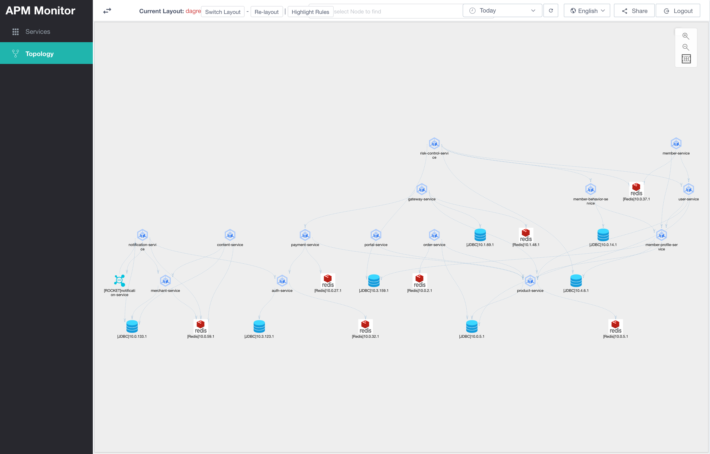

# Topology

The topology graph shows call relationships among services, databases, caches, message queues, and other components within the current time range. Nodes and directed edges help you quickly understand service dependency chains, upstream and downstream impact, and paths where abnormal calls are concentrated.

Page entry:

1. Log in to APM UI.
2. Open `http://localhost:8066/#/topology/list`, or enter "Topology" from the left menu.
3. Select a time range at the top. The page loads topology data for the current time window.

# Feature Description

The topology graph displays call relationships as "nodes + edges":

- A node represents an observable object, such as a service, database, Redis, or MQ.
- An edge represents a call relationship between two nodes, and the arrow indicates call direction.
- Hovering over a node temporarily highlights its incoming and outgoing edges, making upstream and downstream relationships easier to distinguish.
- Clicking an alerted edge shows the alert rule and current metric data that matched the edge.
- Right-clicking a node opens an action menu for locking, hiding, showing, or resetting nodes and related edges.
- Right-clicking an edge hides that edge individually.

Topology is useful when you need to:

- View the overall system architecture.
- Inspect which downstream components an abnormal service depends on.
- Analyze the blast radius of an incident by identifying affected upstream services.
- Lock or hide unrelated nodes in a large topology so the canvas focuses on the current investigation path.
- Use highlight rules to quickly find services or dependency edges with abnormal call count, response time, or error count.

# Page Controls

The common filter area at the top affects topology queries:

| Control | Description |
| --- | --- |
| Time range | Defaults to the last 30 minutes. You can also select a custom range. Topology data is queried again for the selected range. |
| Time zone | Controls how the time range is interpreted. Defaults to the current UI time zone. |
| Refresh | Reloads topology data using the current time range. |
| Language | Switches between Chinese and English UI. |
| Share | Copies the current page link so you can share the current view. |

The topology canvas also provides these actions:

| Control | Description |
| --- | --- |
| Current layout | Shows the current graph layout. `dagre`, `grid`, and `force2` are currently supported. |
| Switch layout | Switches between layouts to adjust node placement. |
| Relayout | Recalculates node positions using the current layout. |
| Highlight rules | `TBD`. Opens the topology highlight-rule list for maintaining alert and highlight conditions. |
| Node search | After you enter or select a node name, the canvas focuses on that node and briefly highlights its label. |
| Zoom in | Zooms in on the topology canvas. |
| Zoom out | Zooms out from the topology canvas. |
| Fit view | Automatically fits the visible topology into the canvas. |

# Graph Elements

Edges represent call relationships. By default, edges are blue dashed lines with direction arrows. When a node is hovered or locked, incoming and outgoing edges are highlighted with different colors:

| State | Description |
| --- | --- |
| Incoming-edge highlight | Indicates upstream relationships that call the current node. |
| Outgoing-edge highlight | Indicates downstream relationships called by the current node. |
| Locked highlight | Keeps the current highlighted relationships on the canvas after the mouse leaves. |

# Node Context Menu

Right-click a topology node to open the node action menu. The menu is divided into "Lock and unlock", "Show and hide", and "Global actions".

## Lock and Unlock

| Menu item | Description | Use case |
| --- | --- | --- |
| Lock related nodes | Locks the current node's relationships. After locking, the current node's incoming and outgoing edges remain highlighted. | Use when you need to keep viewing a service's upstream and downstream call relationships. |
| Unlock related nodes | Unlocks the current node's related edges and restores normal display. | Use after investigation is complete and fixed highlighting is no longer needed. |
| Show locked nodes only | Keeps only the current node and its locked related range, hiding unrelated nodes and edges. | Use in large topologies to reduce noise and focus on the current investigation target. |

"Show locked nodes only" is useful for quickly narrowing a complex topology. A common workflow is to right-click the target node and choose "Show locked nodes only". The canvas hides nodes and edges unrelated to the current investigation path and automatically relayouts the graph.

## Show and Hide

| Menu item | Description | Use case |
| --- | --- | --- |
| Hide edges | Hides all related edges of the current node while keeping the node itself on the canvas. | Use when you temporarily do not care about a node's call relationships but want to keep its position. |
| Show edges | Shows related edges of the current node. An edge is restored only when both endpoint nodes are visible. | Use to manually restore related edges that were just hidden. |
| Hide current node and edges | Hides the current node and its directly related edges. If a related node has no other visible edge after that, it is hidden too; unrelated downstream relationships are not hidden recursively. | Use to remove the current node from the canvas and reduce visual complexity. |
| Show related nodes | Shows directly related nodes of the current node and restores direct edges between them and the current node; it does not expand further upstream or downstream edges of those related nodes. | Use to recover one-hop relationships after hiding part of the graph. |

## Global Actions

| Menu item | Description | Use case |
| --- | --- | --- |
| Reset topology | Clears locked state, shows all nodes and edges, relayouts the graph, and fits it to the canvas. | Use when the canvas has gone through several hide, lock, or zoom operations and should return to the initial topology state. |
