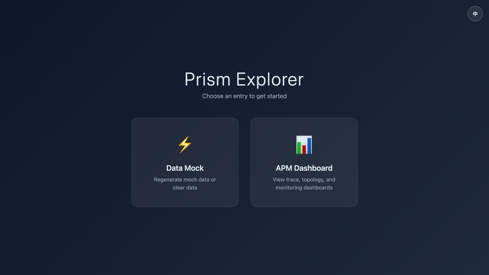
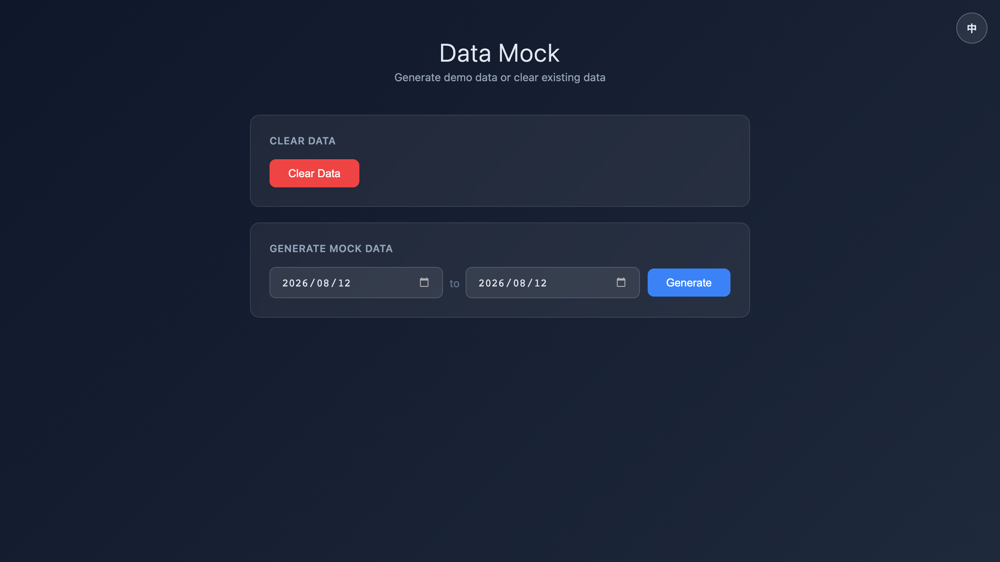
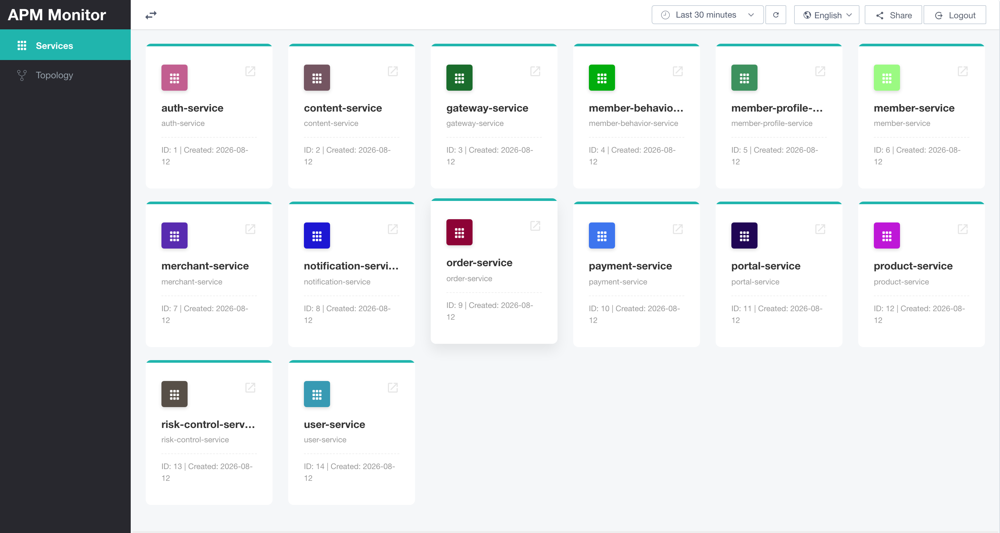
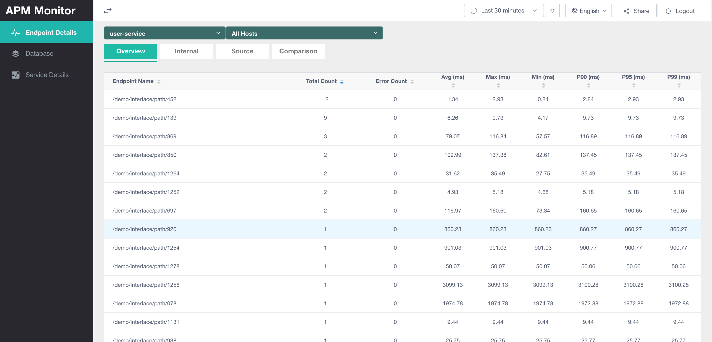

# Quickstart

This guide explains how to use `prism-explorer` to quickly try Prism APM locally.

`prism-explorer` starts a demo environment through Docker Compose, including:

- Prism Explorer
- Prism APM UI Server
- Prism APM UI
- TimescaleDB

After startup, you can open the UI directly and generate mock observability data to try the service overview, topology, endpoint details, and other features.

## Before You Start

The current startup scripts build the Java modules and frontend assets on your local machine before starting Docker Compose, so the following tools must be installed locally:

| Tool | Minimum version | Description |
| --- | --- | --- |
| Docker Desktop | 4.0 or later | Must support the `docker compose` v2 command. |
| JDK | 21 | Backend modules are compiled and run with Java 21. |
| Maven Wrapper | Maven 3.9.9, managed by `./mvnw` | Builds `prism-explorer`, `prism-apm-common`, and `prism-apm-ui-server` without requiring a local Maven installation. |
| Node.js | 22.12.0 or later | Required by `engines.node` in `prism-apm-ui/package.json`. |
| npm | 10 or later | Usually installed with Node.js; used to install frontend dependencies and run builds. |

## Clone the Code

```bash
git clone https://github.com/prism-apm/prism-apm.git
cd prism-apm
```

## Start Everything

### macOS / Linux

```bash
cd prism-explorer
./build-and-up.sh
```

### Windows PowerShell

Open PowerShell as Administrator and run:

```powershell
cd prism-explorer
.uild-and-up.ps1
```

The script automatically:

1. Cleans the old Docker Compose environment.
2. Builds `prism-explorer`.
3. Builds `prism-apm-common`.
4. Builds `prism-apm-ui-server`.
5. Builds `prism-apm-ui`.
6. Starts the Docker Compose services.

## Open Prism Explorer

After startup, open this address in your browser:

```text
http://localhost/
```

This is the Prism Explorer entry page. From here, you can open the mock data page or jump to the Prism APM UI.



## Generate Mock Data

In Prism Explorer, open the `Data Mock` page, choose a date range, and click `Start Generation`.



To try again from a clean state, click `Clear Data` on the same page and generate data again.

## View Prism APM UI

Open:

```text
http://localhost:8066/
```

After entering Prism APM UI, you can view the generated mock data.

We recommend checking these pages in order:

- Service overview: confirm that service metrics are displayed.
- Topology: inspect call relationships between services, databases, and middleware.
- Endpoint details: view the endpoint list, call counts, error counts, and response-time percentiles for a single service.






## Stop Services

After trying the demo, stop the local environment:

```bash
cd prism-explorer
docker compose down
```

To clean up images created during builds, run:

```bash
docker image prune
```

## FAQ

### Port Already in Use

Prism Explorer uses these ports by default:

| Service | Port |
| --- | --- |
| Prism Explorer | `80` |
| Prism APM UI | `8066` |
| TimescaleDB | `15432` |

If another service already uses these ports on your machine, stop that service first or change the port mappings in `prism-explorer/docker-compose.yml`.

### Page Opens but Has No Data

Check in this order:

1. Confirm that all services are running in `docker compose ps`.
2. Open `http://localhost/` and go to the `Data Mock` page.
3. Click `Start Generation` and wait for the task to complete.
4. Refresh `http://localhost:8066/`.

### Build Failed

The current scripts depend on local JDK, Node.js, npm, Docker, and the repository Maven Wrapper. First confirm that these commands work and meet the minimum versions listed in "Before You Start":

```bash
java -version
./mvnw -version
node -v
npm -v
docker version
```

## Next Steps

After the local demo works, continue with:

- Feature docs: learn how to ingest real OpenTelemetry Trace data.
- Deployment docs: learn how to deploy the full environment.
- Configuration docs: learn about TimescaleDB, UI Server, and frontend configuration.
