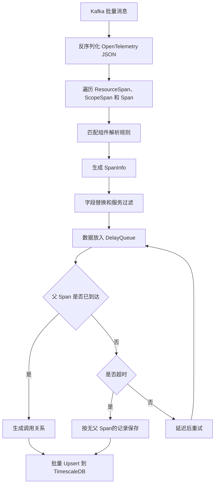
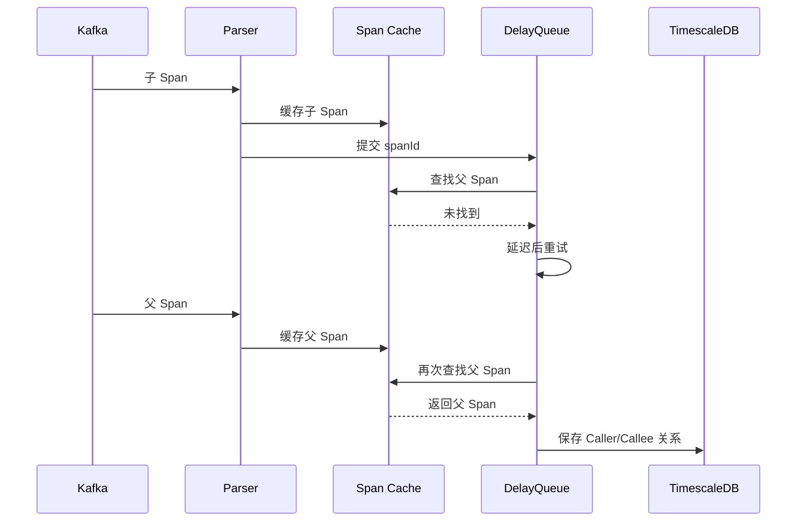

`prism-apm-parser` 负责消费、解析和保存 Trace 数据，是 Prism APM 的数据写入端。

# 职责

Parser 负责：

- 从 Kafka 批量消费 OpenTelemetry Trace JSON。
- 将 Span 转换为统一的内部模型。
- 根据规则提取服务、接口、组件和目标资源等字段。
- 关联父子 Span，生成服务调用关系。
- 将结果批量写入 TimescaleDB。
- 支持指定时间范围的数据重处理。

Parser 不负责：

- 直接接收 OTLP HTTP 或 OTLP gRPC 数据。
- 保存和查询完整的原始 Trace。

当前只实现了 OpenTelemetry JSON 解析器。

# 架构位置


Parser 和 UI Server 通过数据库解耦：

- Parser 负责写入数据。
- UI Server 负责查询数据。

# 输入和输出

## 输入

Parser 从以下 Kafka Topic 消费数据：

| 配置项 | 默认值 | 用途 |
| --- | --- | --- |
| `parser.kafka_topic` | `opentelemetry-trace` | 接收正常 Trace 数据。 |
| `parser.reprocessing_kafka_topic` | `reprocessing-opentelemetry-trace` | 接收重处理数据。 |

每条 Kafka 消息应为一个 OpenTelemetry Trace JSON，主要结构如下：

```text
resourceSpans
  -> scopeSpans
    -> spans
```

Parser 不接收 OTLP Protobuf。Collector 需要先将数据转换为 Parser 支持的 JSON 格式，再发送到 Kafka。

生产环境建议：

- 使用 `traceId` 作为 Kafka 消息 Key。
- Collector 按 `traceId` 选择 Kafka Partition。
- Kafka Topic 的 Partition 数量不小于 Parser 的消费并发数。
- Collector、Kafka Broker 和 Kafka Consumer 使用一致的消息大小限制。

**同一 Trace 的 Span 应进入同一 Partition**。这是父子 Span 能够在同一个 Parser 实例中完成关联的重要前提。

## 输出

Parser 主要写入以下数据库对象：

| 对象                         | 用途                                   |
| -------------------------- | ------------------------------------ |
| `service_call`             | 保存标准化后的服务调用记录。                       |
| `resource_hash_dictionary` | 保存目标资源名称与 Hash 的映射。此目的主要是为了减少数据存储压力。 |

数据库结构定义在：

- `sql/10_create_service_call_objects.sql`
- `sql/11_create_app_config_objects.sql`

# 处理流程




# 内部数据模型

Parser 使用 `SpanInfo` 作为统一的 Span 模型。

| 字段 | 含义 |
| --- | --- |
| `traceId` | Trace 标识。 |
| `spanId` | Span 标识。 |
| `parentSpanId` | 父 Span 标识。 |
| `serviceName` | 服务名称。 |
| `hostName` | 主机名称。 |
| `actionName` | 接口或操作名称。 |
| `targetName` | 被访问的接口、数据库语句或消息目标。 |
| `systemType` | 系统类型，例如 `http`、`redis`、`postgresql`。 |
| `component` | OpenTelemetry Instrumentation Scope 名称。 |
| `spanKind` | Span 类型。 |
| `remoteAddr` | 调用端或目标端地址。 |
| `duration` | Span 持续时间，单位为微秒。 |
| `error` | 错误标记。 |
| `time` | Span 开始时间，单位为 Unix 微秒。 |

写入 `service_call` 时，一条记录同时包含当前 Span 和 Caller 的主要字段。UI Server 使用这些字段查询：

- 服务和接口指标。
- 应用内部调用。
- 上游和下游关系。
- 服务拓扑。


# 父子 Span 关联

Kafka 中的 Span 到达顺序不可靠。子 Span 可能早于父 Span 到达，因此 Parser 使用本地缓存和 DelayQueue 等待父 Span。



相关参数：

| 配置项                                      | 默认值     | 说明                        |
| ---------------------------------------- | ------- | ------------------------- |
| `cache.timeout_s`                        | `600`   | Span 在本地缓存中的保留时间，单位为秒。    |
| `dependency.timeoutThreshold`            | `60000` | 等待父 Span 的最大时间，单位为毫秒。     |
| `delayMillis`                            | `3000`  | 未找到父 Span 时的再次尝试间隔，单位为毫秒。 |
| `delay.component.local.thread_num`       | `4`     | DelayQueue 消费线程数。         |
| `delay.component.local.batch_size`       | `10`    | 每次处理的最大 Span 数量。          |
| `delay.component.local.batch_timeout_ms` | `1000`  | 组装批次的最长等待时间。              |

最好满足以下条件，否则父 Span 信息可能在等待结束前被本地缓存淘汰掉。


```text
cache.timeout_s × 1000 > dependency.timeoutThreshold
```


`dependency.timeoutThreshold` 时间越长：

- 父子关系更完整。
- 本地缓存占用越高。
- 数据写入延迟越大。
- TimescaleDB 连续聚合需要覆盖更长的迟到数据窗口。

`dependency.timeoutThreshold` 时间越短：

- 数据写入更及时。
- 本地等待的 Span 更少，资源占用更低。
- 父 Span 还未到达就可能超时。
- 更多 Span 会按无父 Span 保存，服务调用链、上下游关系和拓扑可能不完整。

# 重处理

**此功能暂还没达到生产环境使用程度**，原因如下：
- 从 Kafka 里读取数据后，解析成到一条条 span 后，发回到 kafka 的速度非常慢。
- 需要大量手动重新聚合相应的表。

Parser 提供数据重处理接口，用于重新消费 Kafka 中指定时间范围的数据。

| 接口                                       | 用途                         |
| ---------------------------------------- | -------------------------- |
| `GET /reprocessing/quick/{timeInterval}` | 重处理最近一段时间的数据，例如 `6m`、`1d`。 |
| `GET /reprocessing/consume`              | 指定 Kafka 起始时间和 Span 时间范围。  |
| `GET /reprocessing/transferData`         | 刷新指定时间范围的连续聚合。             |

默认端口为 `8090`。

## `/reprocessing/quick/{timeInterval}`

快速重处理最近一段时间的数据。

```bash
curl -X GET "http://localhost:8090/reprocessing/quick/6m"
```

`timeInterval` 格式：

| 格式 | 含义 |
| --- | --- |
| `6m` | 最近 6 分钟。 |
| `1d` | 最近 1 天。 |

当前只支持：

- `m`：分钟。
- `d`：天。

该接口会自动计算：

- `startTime = 当前 UTC 时间 - timeInterval`
- `endTime = 当前 UTC 时间`
- `kafkaStartTime = startTime`

适合临时补最近一小段数据。

## `/reprocessing/consume`

从原始 Trace Topic 中按时间重新消费数据，并发送到重处理 Topic。

```bash
curl -X GET "http://localhost:8090/reprocessing/consume?kafkaStartTime=2026-06-30T08:00:00Z&spanStartTime=2026-06-30T08:00:00Z&spanEndTime=2026-06-30T09:00:00Z"
```

参数说明：

| 参数 | 格式 | 含义 |
| --- | --- | --- |
| `kafkaStartTime` | `Instant`，例如 `2026-06-30T08:00:00Z` | 从 Kafka 中哪个时间点对应的 Offset 开始消费。 |
| `spanStartTime` | `Instant`，例如 `2026-06-30T08:00:00Z` | 只处理开始时间大于等于该时间的 Span。 |
| `spanEndTime` | `Instant`，例如 `2026-06-30T09:00:00Z` | 只处理开始时间小于该时间的 Span。 |

时间关系必须满足：

```text
kafkaStartTime <= spanEndTime
spanStartTime <= spanEndTime
```

通常可以让 `kafkaStartTime` 等于 `spanStartTime`。如果担心 Kafka 消息写入时间和 Span 开始时间有偏差，可以把 `kafkaStartTime` 适当提前。

处理逻辑：

1. 根据 `kafkaStartTime` 查找每个 Kafka Partition 的 Offset。
2. 从这些 Offset 开始消费原始 Topic。
3. 解析每条 Trace，取第一个 Span 的开始时间做过滤。
4. 只保留 `[spanStartTime, spanEndTime)` 范围内的数据。
5. 使用 `traceId` 作为 Key，发送到重处理 Topic。
6. 重处理消费者再次解析并写入数据库。


# 并发与扩容

Parser 的最终数据保存在 TimescaleDB，但处理过程中包含本地状态：

- Ehcache Span 缓存。
- 进程内 DelayQueue。

因此 Parser 不是完全无状态服务。每次重启和扩容会造成以下问题：

- 如果对服务进行重启，DelayQueue 中的没有被消费完的 span 丢失。
- 如果对服务进行扩容或缩容，相同 `traceId` 的 trace 可能会进入到不同的 partition 中，造成少量服务间的调用关系不完整。

吞吐量主要受以下因素影响：

- Kafka Partition 数量。
- Kafka 消费并发数。
- DelayQueue 消费线程数。
- 批量写入大小。
- 数据库连接池大小。
- TimescaleDB 写入能力。


# 可靠性

当前处理链路不是端到端事务。

Kafka Offset 在消息完成解析并进入本地缓存和 DelayQueue 后确认，不会等待数据库写入成功。以下情况可能造成数据丢失：

- Offset 已确认，但 Parser 在数据库写入前退出。
- 数据库写入失败。
- 本地缓存或 DelayQueue 中的数据随进程退出而丢失。
- Span 在缓存中过期或被淘汰。


# 日志

Parser 按用途输出日志：

| 文件                     | 内容            |
| ---------------------- | ------------- |
| `server.log`           | 主程序日志。        |
| `stats.log`            | 消费、保存和超时统计。   |
| `cache.log`            | 缓存过期和淘汰记录。    |
| `unparsed_span.log`    | 无法正常解析的 Span。 |
| `unparsed_service.log` | 未参与解析的服务。     |
| `reprocessing.log`     | 数据重处理日志。      |

## `stats.log`

`stats.log` 由 `StatsScheduler` 定时输出，默认每分钟一次。

每次输出包含以下几类内容：

```text
outputStats started
ehcache stats. exists:..., puts:..., gets:..., removals:..., hits:..., misses:..., Evictions:..., Expirations:..., OccupiedByteSize:...
delay queue size:...,reprocessing delay queue size:...
span stats. saved span: ..., timeout span: ...
outputStats end
```

### Ehcache 统计

```text
ehcache stats. exists:10, puts:100, gets:80, removals:5, hits:70, misses:10, Evictions:0, Expirations:2, OccupiedByteSize:20480,
```

字段说明：

| 字段                 | 含义                   |
| ------------------ | -------------------- |
| `exists`           | 当前 Span Cache 中的记录数。 |
| `puts`             | 写入缓存的累计次数。           |
| `gets`             | 查询缓存的累计次数。           |
| `removals`         | 从缓存中移除的累计次数。         |
| `hits`             | 查询缓存命中的累计次数。         |
| `misses`           | 查询缓存未命中的累计次数。        |
| `Evictions`        | 因容量限制被淘汰的累计次数。       |
| `Expirations`      | 因超时过期的累计次数。          |
| `OccupiedByteSize` | 当前缓存占用大小，单位为字节。      |

重点关注：

- `exists` 持续升高：可能有大量 Span 等待父 Span。
- `Evictions` 持续增加：缓存容量可能不足。
- `Expirations` 持续增加：Span 在缓存中等待太久，可能影响父子关系关联。
- `misses` 明显高于 `hits`：父 Span 经常找不到，可能是 Span 到达乱序、Kafka 分区不合理或等待时间太短。

### DelayQueue 统计

```text
delay queue size:12,reprocessing delay queue size:0
```

字段说明：

| 字段                              | 含义                    |
| ------------------------------- | --------------------- |
| `delay queue size`              | 正常消费链路中等待处理的 Span 数量。 |
| `reprocessing delay queue size` | 重处理链路中等待处理的 Span 数量。  |


### Span 统计

```text
span stats. saved span: 1000, timeout span: 20
```

字段说明：

| 字段             | 含义                   |
| -------------- | -------------------- |
| `saved span`   | 已写入数据库的调用记录累计数量。     |
| `timeout span` | 等待父 Span 超时后保存的累计数量。 |
