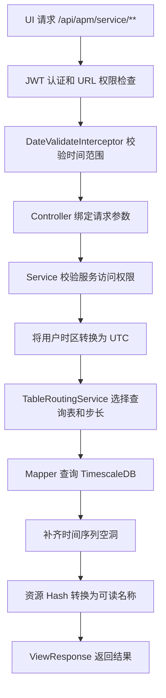

`prism-apm-ui-server` 是 Prism APM 的数据查询与管理后端。它读取 Parser 写入 TimescaleDB 的调用数据和聚合数据，将其转换为前端需要的服务指标、接口分析、依赖拓扑和管理数据。

# 职责

UI Server 负责：

- 提供服务、接口、数据库访问和上下游依赖等查询 API。
- 根据查询时间跨度选择不同粒度的聚合表。
- 将用户输入的本地时间转换为 UTC 后查询数据库。
- 对时间序列补点，并将资源 Hash 还原为可读名称。
- 根据调用关系生成服务、数据库、Redis 和消息队列拓扑。
- 提供基于 JWT、角色、权限和项目组的访问控制。
- 提供用户、角色、权限、项目及项目组的管理 API。
- 管理拓扑预警规则，并返回需要高亮的节点和边。

UI Server 不负责：

- 接收、解析或保存 OpenTelemetry Trace。该职责属于 [Parser](parser_architecture.md)。
- 保存和查询完整的原始 Trace。
- 托管前端静态资源。生产环境应单独部署 `prism-apm-ui`，并将 `/api` 代理到 UI Server。
- 生成 TimescaleDB 连续聚合。聚合对象由 `sql/` 中的数据库脚本创建和维护。

# 架构位置


Parser 和 UI Server 通过数据库解耦：

- Parser 是数据写入端，将 Span 标准化为调用记录。
- TimescaleDB 保存原始调用记录、连续聚合、权限配置和查询路由规则。
- UI Server 是数据读取端，负责权限过滤、查询编排和视图模型转换。
- UI 只依赖 UI Server 的 HTTP API，不直接访问数据库。

UI Server 是无状态服务。JWT 中不保存服务端 Session，多实例可以共享同一套数据库和 JWT 密钥进行横向扩容。

# 内部结构

UI Server 使用 Java 21、Spring Boot 3、Spring Security、MyBatis-Plus 和 PostgreSQL 驱动实现。

```text
org.prism.apm.ui.server
├── config          Spring MVC、Spring Security、MyBatis 等配置
├── controller      查询、拓扑和后台管理 API
├── entity          请求参数、数据库对象、DTO 和响应模型
├── exceptions      业务异常和全局异常处理
├── interceptor     时间范围参数校验
├── mapper          MyBatis Mapper 接口
├── route           动态查询表路由
├── schedule        数据预热等定时任务
├── security        JWT 认证和动态 URL 授权
├── service         查询编排、拓扑计算和后台管理
└── utils           时间轴、补点、参数校验等工具
```

各层的边界如下：

| 层 | 作用 |
| --- | --- |
| `controller` | 接收 HTTP 参数，调用 Service，并包装统一响应。Controller 不直接执行 SQL。 |
| `service` | 执行业务校验、权限过滤、表路由、查询组合和结果转换。 |
| `mapper` | 通过 Mapper 接口和 XML 执行 PostgreSQL/TimescaleDB 查询。 |
| `route` | 根据查询跨度和数据类型选择目标表及时间步长。 |
| `security` | 从 JWT 恢复身份，并根据数据库中的 URL 权限规则授权。 |

# 查询流程

以服务指标查询为例，一次请求会经过以下步骤：



## 时间参数

指标查询通常接收以下参数：

| 参数 | 格式 | 说明 |
| --- | --- | --- |
| `startDate` | `yyyy-MM-dd HH:mm:ss` | 用户所在时区中的开始时间。 |
| `endDate` | `yyyy-MM-dd HH:mm:ss` | 用户所在时区中的结束时间。 |
| `timezone` | IANA Zone ID | 例如 `Asia/Shanghai`，用于处理时区偏移和夏令时。 |

`DateValidateInterceptor` 当前对 `/api/apm/common/**` 和 `/api/apm/service/**` 生效：

- `startDate` 和 `endDate` 必须同时提供。
- 查询跨度至少为 1 分钟。
- 查询跨度不能超过 360 天。
- 这些路径下的 GET 请求必须提供 `timezone`。当前实现中，即使接口本身不使用时间参数也会执行该检查。

拓扑查询不经过该拦截器，由 Controller 将 `DateParam` 转换为 UTC。新增时间范围接口时，应明确将路径加入拦截器，或在 Service 中执行等价校验。

Service 将本地时间转换为 UTC，SQL 使用 UTC 时间过滤数据。返回结果再根据路由步长生成完整时间轴，缺失的时间桶会补为默认值，避免图表断点或错位。

## 动态表路由

同一类数据会按分钟、5 分钟、小时或天等粒度保存。短时间查询需要细粒度，长时间查询更适合聚合表。`TableRoutingService` 根据查询跨度从 `table_routing_rules` 选择查询表，避免每个 Service 硬编码表名。

当前路由标签包括：

| 标签 | 用途 |
| --- | --- |
| `entry` | 服务入口和接口指标。 |
| `dependency` | 下游依赖、数据库和内部调用指标。 |
| `topology` | 服务及中间件拓扑关系。 |
| `hostname` | 指定时间范围内的服务实例列表。 |

每条规则包含时间跨度区间、目标表、数据步长和规则类型：

- `SIMPLE`：直接使用 `target_table`。
- `COMPLEX`：先计算安全 Chunk 边界。历史 Chunk 已完成优化时使用 `optimized_table`，否则使用 `target_table`。
- `data_step`：结果的时间粒度，单位为分钟，例如 `1`、`5`、`60` 或 `1440`。

应用启动时，`TableRoutingStore` 从数据库加载规则，并按标签检查时间区间是否存在空洞、重叠或位置错误的无限区间。规则不合法时启动失败，防止查询在运行期静默选错表。

# 核心能力

## 服务与接口分析

`/api/apm/service/**` 提供以下查询能力：

| 能力 | 说明 |
| --- | --- |
| 服务概览 | 查询服务级请求量、错误和耗时等指标。 |
| 服务详情 | 按时间轴查看服务指标，可按机器过滤。 |
| 接口列表 | 查询服务入口接口及其指标。 |
| 接口详情 | 对比入口接口和内部调用的 RED 指标。 |
| 内部调用图 | 分析一个入口接口内部访问的接口和资源。 |
| 上游分析 | 按接口或服务聚合“谁在调用我”。 |
| 数据库分析 | 查询数据库等依赖的列表和详细指标。 |

指标查询主要读取 Parser 产出的 `service_call` 数据及其 TimescaleDB 连续聚合。`resource_hash_dictionary` 用于把压缩存储的资源 Hash 转换回接口、SQL 或消息目标名称。

## 公共查询

`/api/apm/common/**` 提供服务列表、主机列表和图表时间轴。

服务列表不是数据库中所有服务的无条件全集：

- 管理员可以访问全部项目。
- 普通用户只能访问其所在项目组关联的项目。
- 查询具体服务时，Service 层会再次校验服务是否在当前用户的可访问集合中。

项目的 `name` 与 APM 数据中的服务名关联，因此项目配置直接决定普通用户能够查看哪些服务数据。

## 服务拓扑

`/api/apm/topology/topology-data/getData` 返回 `nodes`、`edges` 和 `highlights`：

- RPC 调用生成服务到服务的边。
- JDBC 和 Redis 调用生成服务到外部资源的边。
- Kafka 和 RocketMQ 数据生成生产者、消息目标和消费者之间的边。
- 重复边会按 `source::target` 去重。
- 当前用户不可访问的服务不会作为拓扑查询入口。

拓扑预警规则可以根据指标阈值找出异常服务，并计算上下游边的影响比例，供前端高亮节点和边。规则的增删改、启停由 `/api/apm/topology/topology-warning-rules/**` 提供。

## 后台管理

`/api/admin/**` 提供以下管理能力：

- 用户、角色和权限的增删改查。
- 项目和项目组的增删改查。
- 用户与角色、角色与权限之间的分配关系。
- 用户与项目组、项目组与项目之间的分配关系。

写操作使用 `master` 数据源并在 Service 层开启事务。普通查询默认使用 `slave` 数据源。单数据库部署时，读写数据源可以指向同一个 PostgreSQL/TimescaleDB 实例。

# 认证与授权

UI Server 使用无状态 JWT 认证：

1. 客户端向 `/api/apm/login` 提交用户名和密码。
2. 登录成功后，服务端返回签名 JWT。
3. 后续请求通过 `Authorization: Bearer <token>` 携带 JWT。
4. `JwtAuthenticationFilter` 校验签名和过期时间，并从数据库加载用户角色。
5. `CustomAuthorizationManager` 根据请求 URL 和角色决定是否放行。

授权模型包含两个层次：

| 层次 | 保护对象 | 实现方式 |
| --- | --- | --- |
| API 权限 | 某个角色能否访问一个 URL | 权限表中的 URL Pattern 与角色权限关系。 |
| 数据权限 | 用户能否查看某个服务 | 用户、项目组和项目的关联关系。 |

`ROLE_ADMIN` 具有 API 超级权限，并可查看全部项目。其他用户必须命中数据库中的 URL 权限规则；未配置的 URL 默认拒绝访问。权限规则在应用启动时载入内存，之后每 60 秒刷新一次，因此权限变更最多需要约 60 秒才能在所有实例生效。

> 当前密码编码器为 `NoOpPasswordEncoder`。它只适合受控开发环境。公开部署前应改为 BCrypt 或其它自适应单向密码哈希，并迁移已有密码。

# API 约定

所有 `@RestController` 会自动增加 `/api` 前缀。主要接口分组如下：

| 路径 | 说明 |
| --- | --- |
| `/api/apm/login` | 登录并获取 JWT。 |
| `/api/apm/logout` | 客户端登出。服务端无 Session，客户端应同时删除 JWT。 |
| `/api/apm/common/**` | 服务、机器和时间轴等公共查询。 |
| `/api/apm/service/**` | 服务、接口、依赖和数据库指标查询。 |
| `/api/apm/topology/**` | 拓扑数据和拓扑预警规则。 |
| `/api/admin/**` | 用户、角色、权限、项目和关联关系管理。 |

普通业务接口使用统一响应：

```json
{
  "status": 200,
  "msg": "OK",
  "data": {}
}
```

分页接口额外返回 `total`。业务异常由 `GlobalExceptionHandler` 转换为失败响应，未处理异常只返回“内部服务器错误”，详细堆栈写入服务端日志。

本文档只描述接口分组和架构约定。参数、响应字段和示例应维护在独立的 API 文档中，避免接口变化与架构说明互相干扰。

# 数据源与配置

主要配置位于：

```text
prism-apm-ui-server/src/main/resources/application.properties
```

| 环境变量 | 是否必需 | 说明 |
| --- | --- | --- |
| `DB_WRITE_ENDPOINT` | 是 | 写库地址，格式为 `host:port`。 |
| `DB_WRITE_DB_NAME` | 是 | 写库数据库名。 |
| `DB_WRITE_USERNAME` | 是 | 写库用户名。 |
| `DB_WRITE_PASSWORD` | 是 | 写库密码。 |
| `DB_READ_ENDPOINT` | 是 | 读库地址，格式为 `host:port`。 |
| `DB_READ_DB_NAME` | 是 | 读库数据库名。 |
| `DB_READ_USERNAME` | 是 | 读库用户名。 |
| `DB_READ_PASSWORD` | 是 | 读库密码。 |
| `JWT_SECRET` | 是 | JWT HMAC 密钥。HS256 至少需要 32 字节；配置中的默认占位值不能用于实际启动。 |
| `JWT_EXPIRATION` | 否 | JWT 有效期，单位为毫秒，默认 `86400000`。 |

可选的 TimescaleDB 预热任务由以下配置控制：

| 配置项 | 默认值 | 说明 |
| --- | --- | --- |
| `apm.schedule.prewarm-enabled` | `false` | 是否启用预热任务。 |
| `apm.schedule.prewarm-function` | `prewarm_data` | 调用的数据库函数。 |
| `apm.schedule.prewarm-cron` | `* 0/10 * * * ?` | 任务 Cron 表达式。 |

数据库对象和初始数据由 `sql/` 目录维护。详细初始化、构建和启动步骤见 [Parser 配置](../configuration/parser_configuration.md)、[UI Server 配置](../configuration/ui-server_configuration.md)、[开发](../development.md) 和 [部署](../deployment.md)。

# 扩展指南

## 增加指标查询

增加新的指标查询时，通常需要：

1. 在 `entity/param` 和 `entity/response` 定义请求与响应模型。
2. 在 `mapper` 接口及对应 XML 中增加查询。
3. 在 `service` 中完成参数校验、服务权限校验、UTC 转换和表路由。
4. 对时间序列结果按 `RouteInfo.dataStep` 补点。
5. 在 `controller` 中暴露接口并使用 `ViewResponse` 包装结果。
6. 在权限初始化数据中为新 URL 配置角色权限。
7. 为路由边界、SQL 查询和权限过滤补充测试。

不要在 Mapper XML 中直接拼接用户传入的表名。动态表名必须来自通过校验的 `table_routing_rules`，业务过滤值使用 MyBatis 参数绑定。

## 增加一种聚合粒度

新的粒度需要同时修改：

- `sql/` 中的连续聚合或目标表。
- `table_routing_rules` 中对应标签的时间区间与 `data_step`。
- 时间轴和补点逻辑对该步长的支持。
- 路由规则和 Mapper 查询测试。

同一标签下的规则必须从 0 秒开始连续覆盖所有查询跨度，不能重叠，也不能留下空洞。

# 测试重点

UI Server 的测试主要覆盖：

- 表路由的边界、空洞、重叠和 Chunk 安全边界。
- 服务、目标资源和数据库指标 Mapper 的实际 SQL。
- 用户、角色、权限、项目及关联关系的事务行为。
- PostgreSQL/TimescaleDB 索引与查询计划检查。

涉及 Mapper 或 TimescaleDB 特性的测试应使用真实 PostgreSQL/TimescaleDB 环境，而不是依赖与生产 SQL 方言不一致的内存数据库。
