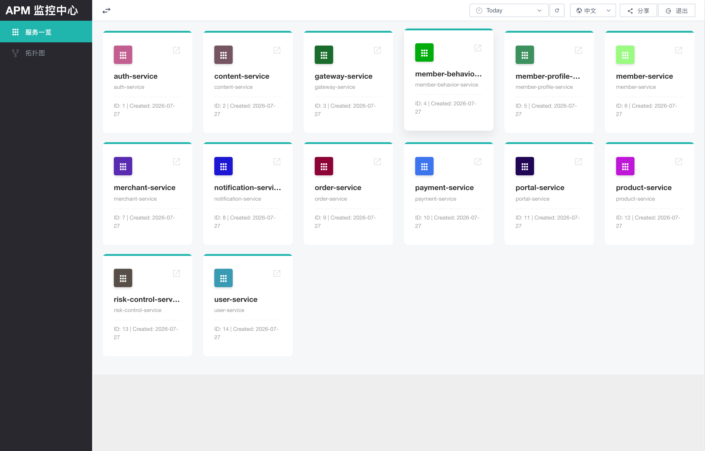
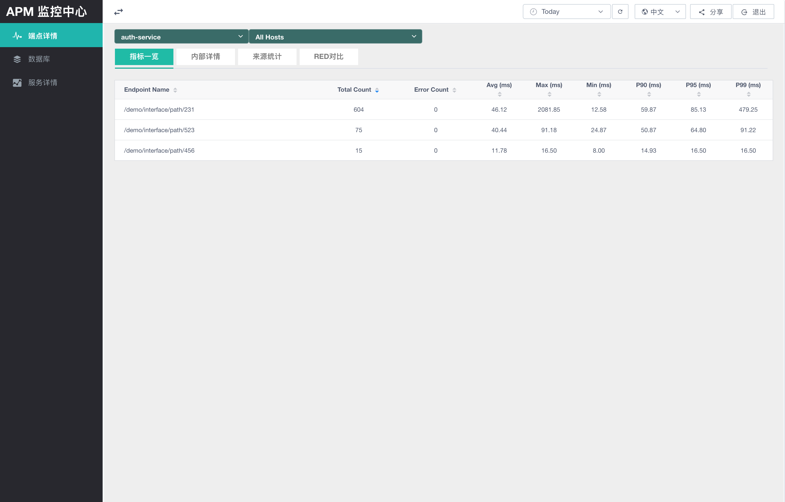
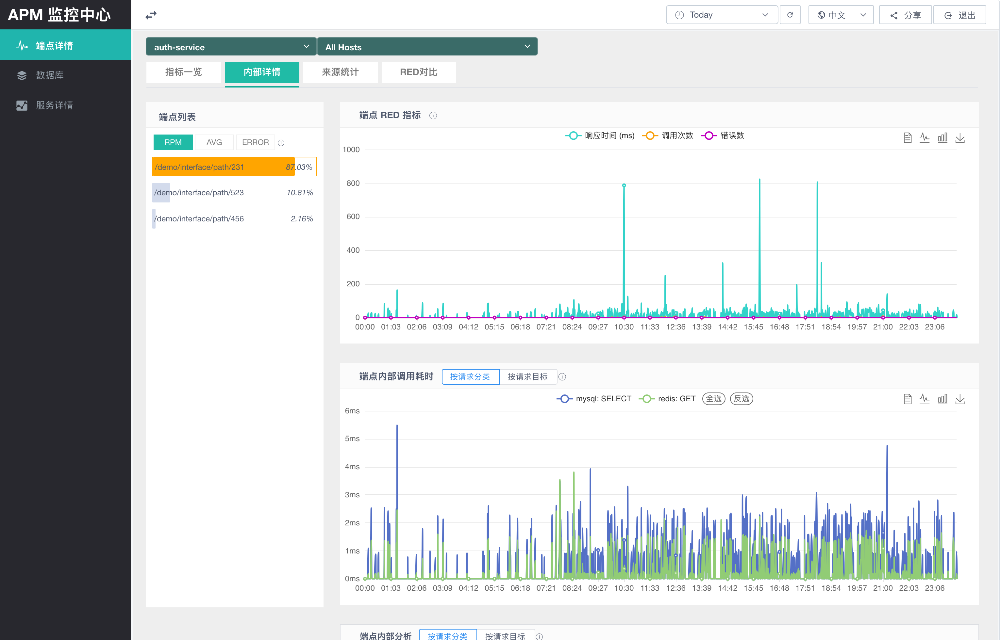
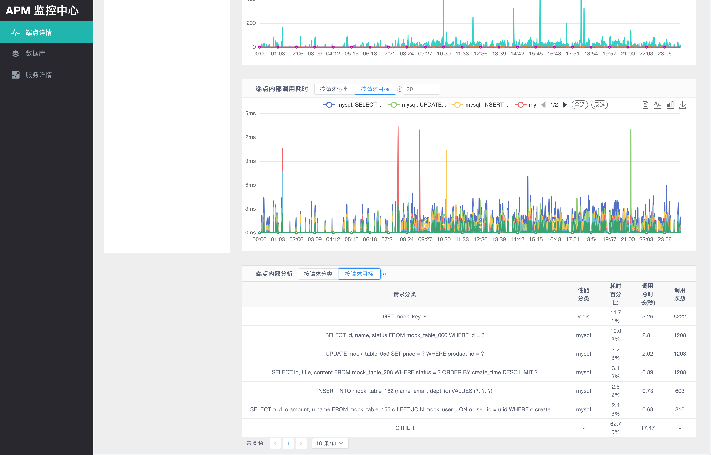
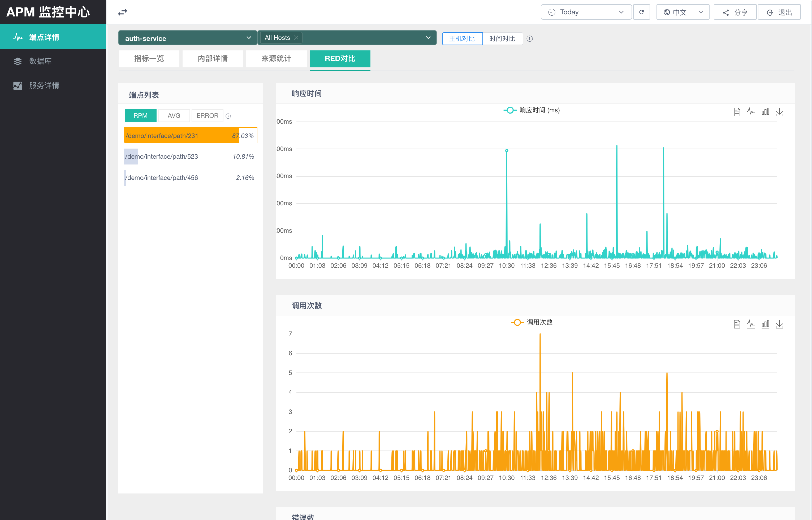
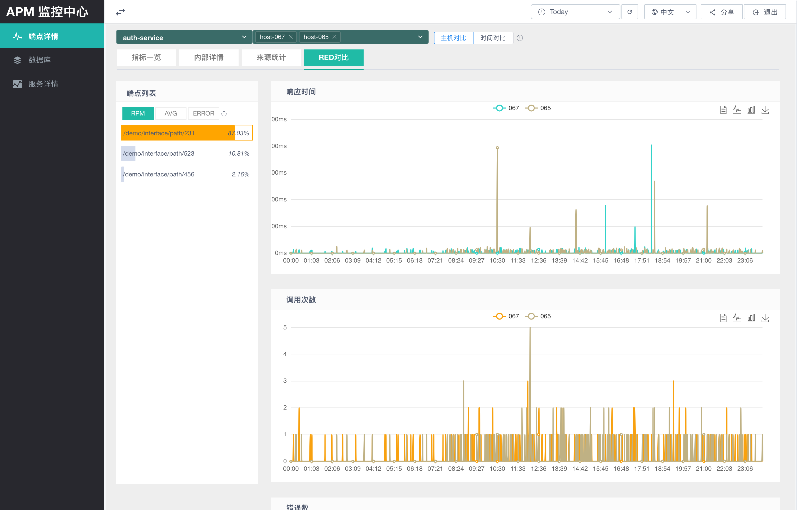

服务指标用于从 APM 采集到的服务调用数据中查看服务、端点和依赖调用的运行状态。它帮助运维和研发人员快速判断某个服务在指定时间范围内的请求量、响应时间、错误数、慢端点、内部依赖耗时以及调用来源。

端点详情页面需要先从 `http://localhost:8066/#/overview/application` 进入服务一览，选择一个服务后再进入。

# 功能说明

服务指标页面以“服务”为入口，以“端点”为主要分析对象。页面会在全局时间范围、服务和主机筛选条件下，展示所选服务的端点指标、单端点 RED 曲线、端点内部调用拆解、调用来源统计和 RED 对比。

核心能力包括：

- 查看服务下所有端点的调用量、错误数、平均耗时、最大耗时、最小耗时和 P90/P95/P99 分位耗时。
- 按端点进入更细粒度分析，观察单个端点随时间变化的 RED 指标。
- 拆解端点内部调用耗时，识别主要耗时来自 SQL、HTTP、Redis、MQ 或其他内部请求。
- 查看谁调用了当前端点，按来源端点和来源服务统计调用贡献。
- 对同一端点进行主机对比或时间对比，比较响应时间、调用次数和错误数的变化。

服务指标适合用于以下排查和分析场景：

- 某个端点变慢时，进入“内部详情”，查看端点 RED 曲线和内部调用耗时拆解。
- 需要确认流量来源时，进入“来源统计”，查看来源端点和来源服务。
- 需要判断问题是否只发生在某台主机或某个时间段时，进入“RED对比”进行主机对比或时间对比。
- 服务整体变慢时，先在指标一览中按 `Avg (ms)`、`P95 (ms)` 或 `P99 (ms)` 排序，找出慢端点。
- 某个服务请求量突增时，按 `Total Count` 排序确认主要流量入口。
- 出现错误时，按 `Error Count` 排序确认错误集中在哪些端点。

# 页面入口与筛选

在服务一览页面中选择要分析的服务卡片，即可进入该服务的端点详情页面。

进入页面后，顶部公共筛选区会影响后续所有查询：

| 控件 | 说明 |
| --- | --- |
| 时间范围 | 默认显示最近 30 分钟，也可以选择自定义时间范围。 |
| 服务选择 | 当前分析的服务。该值通常由“服务一览”卡片点击后带入，也可以在端点详情页顶部切换。 |
| 主机选择 | 默认 `All Hosts`，表示查询该服务的全部主机。选择单台主机后，页面只展示该主机上的调用指标。 |
| 刷新 | 按当前筛选条件重新查询数据。 |
| 语言 | 支持中文和英文界面切换。 |
| 分享 | 复制当前页面链接，并带上服务名和时间范围参数，便于把同一分析视图分享给其他人。 |

页面左侧导航中，与服务指标相关的视图包括：

| 菜单 | 说明 |
| --- | --- |
| 端点详情 | 当前文档描述的端点指标、内部详情、来源统计和 RED 对比页面。 |
| 数据库 | 按数据库或外部依赖调用维度查看指标。 |
| 服务详情 | 按时间轴查看服务级别指标。 |

# 指标一览

“指标一览”是端点详情页的默认标签页。它以表格列出当前服务在所选时间范围内的端点指标。

| 字段              | 含义                 |
| --------------- | ------------------ |
| `Endpoint Name` | 端点名称或接口路径。         |
| `Total Count`   | 当前时间范围内该端点的总调用次数。  |
| `Error Count`   | 当前时间范围内该端点的错误调用次数。 |
| `Avg (ms)`      | 平均响应时间，单位毫秒。       |
| `Max (ms)`      | 最大响应时间，单位毫秒。       |
| `Min (ms)`      | 最小响应时间，单位毫秒。       |
| `P90 (ms)`      | 90 分位响应时间，单位毫秒。    |
| `P95 (ms)`      | 95 分位响应时间，单位毫秒。    |
| `P99 (ms)`      | 99 分位响应时间，单位毫秒。    |

表格列支持排序。常见使用方式：

- 按 `Total Count` 降序查看高流量端点。
- 按 `Error Count` 降序查看错误集中端点。
- 按 `Avg (ms)`、`P95 (ms)` 或 `P99 (ms)` 降序查看慢端点。

如果当前时间范围内没有端点数据，切换到其他标签页时会提示“当前所选时间段内没有数据, 请重新选择”。

# 内部详情

“内部详情”用于分析单个端点的 RED 指标和端点内部调用耗时。

左侧“端点列表”用于选择要分析的端点，并支持按以下指标排序：

| 排序项 | 说明 |
| --- | --- |
| `RPM` | 按端点调用量排序。 |
| `AVG` | 按端点平均响应时间排序。 |
| `ERROR` | 按端点错误数排序。 |

端点列表中的百分比表示当前端点指标值占服务端点总指标值的比例。例如按 `RPM` 排序时，百分比表示该端点调用次数占当前服务端点总调用次数的比例。

右侧包含三块内容：

| 区域 | 说明 |
| --- | --- |
| 端点 RED 指标 | 展示所选端点随时间变化的响应时间、调用次数和错误数。RED 是复合指标，因此图表 Y 轴不固定为单一单位。 |
| 端点内部调用耗时 | 展示端点内部调用的耗时趋势。可以按“请求分类”或“请求目标”聚合。 |
| 端点内部分析 | 用表格展示内部调用的聚合结果，包括请求分类、性能分类、耗时百分比、调用总时长和调用次数。 |

内部调用聚合方式：

| 聚合方式 | 说明 |
| --- | --- |
| 按请求分类 | 按内部调用类别聚合，例如 `SELECT`、`GET`、`POST`、`OTHER`。适合快速判断耗时来自哪类操作。 |
| 按请求目标 | 按具体请求目标聚合，例如某个 SQL、URL 或外部系统目标。适合定位具体慢依赖。该方式数据可能较多，默认加载 20 条，可通过输入框调整展示数量。 |

下半部分可以在“端点内部调用耗时”和“端点内部分析”中按“请求分类”或“请求目标”切换视角。

“端点内部分析”表格字段说明：

| 字段 | 含义 |
| --- | --- |
| 请求分类 | 内部调用动作或聚合名称。 |
| 性能分类 | 内部调用所属系统类型，例如 `mysql`、`http` 等。 |
| 耗时百分比 | 该内部调用耗时占端点总耗时的比例。 |
| 调用总时长(秒) | 当前时间范围内累计耗时，单位秒。 |
| 调用次数 | 当前时间范围内累计调用次数；对于无法统计次数的聚合项可能显示 `-`。 |

# 来源统计

“来源统计”用于回答“谁在调用这个端点”。进入该标签页后，仍然需要先在左侧端点列表中选择目标端点。

页面上方展示三张来源端点占比图：

| 图表 | 说明 |
| --- | --- |
| 总调用时长占比 | 各来源端点贡献的总耗时比例。 |
| 总调用次数占比 | 各来源端点贡献的调用次数比例。 |
| 平均耗时占比 | 各来源端点的平均耗时比例。 |

页面下方包含两张表：

| 表格 | 说明 |
| --- | --- |
| 端点调用来源分析 -> 按来源端点 | 按来源服务和来源方法统计调用情况。 |
| 端点调用来源分析 -> 按来源服务 | 按来源服务聚合统计调用情况。 |

来源统计字段说明：

| 字段       | 含义                           |
| -------- | ---------------------------- |
| 调用来源服务   | 调用当前端点的上游服务。                 |
| 调用来源方法   | 调用当前端点的上游方法或端点。仅“按来源端点”表格展示。 |
| 调用总时长(秒) | 来源维度累计调用耗时，单位秒。              |
| 总调用次数    | 来源维度累计调用次数。                  |
| 平均值(毫秒)  | 来源维度平均响应时间，单位毫秒。             |

注意：
- 来源非可识别服务时显示成 `UNKNOWN`。

“按来源端点”表格支持按调用总时长、总调用次数和平均耗时排序，并支持分页。

# RED 对比

“RED对比”用于比较同一端点在不同主机或不同时间范围下的表现。进入该标签页后，页面会显示对比控件，并展示三张折线图：

| 图表 | 说明 |
| --- | --- |
| 响应时间 | 对比端点响应时间趋势。 |
| 调用次数 | 对比端点调用次数趋势。 |
| 错误数 | 对比端点错误数趋势。 |

支持的对比方式：

| 对比方式 | 说明                                                     |
| ---- | ------------------------------------------------------ |
| 主机对比 | 在同一时间范围内比较不同主机上的同一端点。适合判断问题是否集中在某台机器。现在只能对两个主机的数据进行对比。 |
| 时间对比 | 以当前时间范围为基准，选择另一个时间范围进行对比。适合判断发布、配置变更或流量变化前后的影响。        |

主机对比会在同一时间范围内展示两台主机的曲线差异。

时间对比会把当前时间范围与另一个时间范围叠加展示，例如对比今天和昨天。

如果对比时间范围或目标主机没有可用数据，页面会提示“时间范围内无可用对比数据”。
