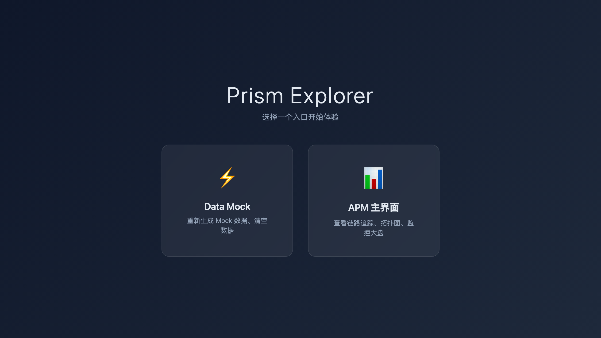
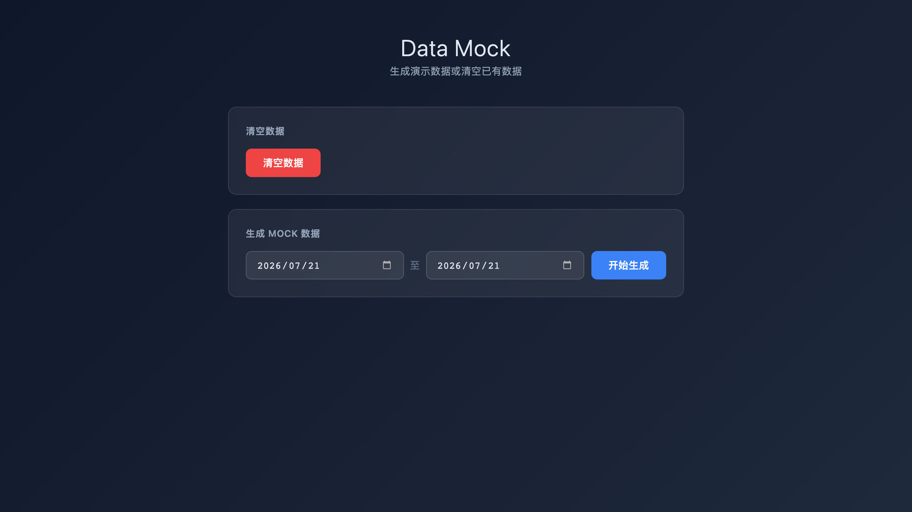
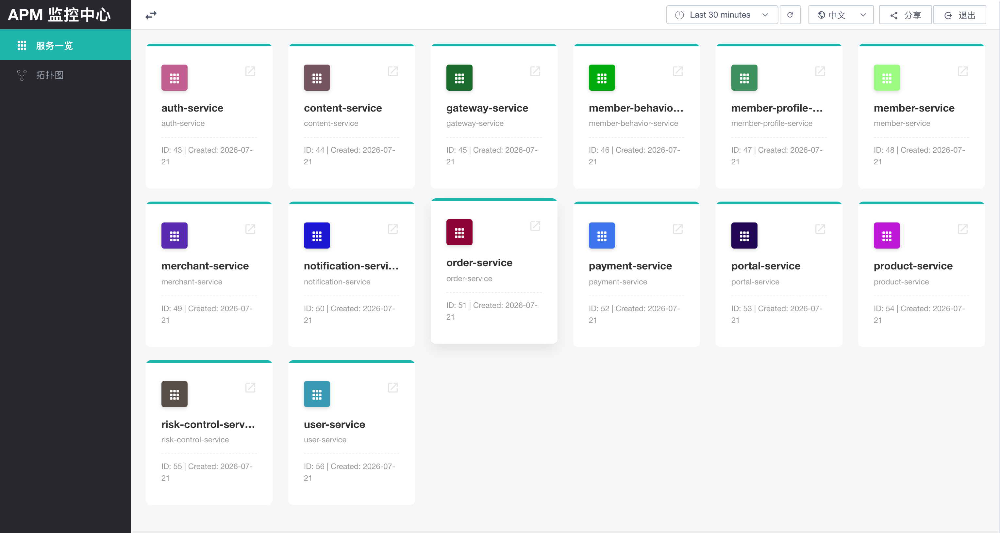
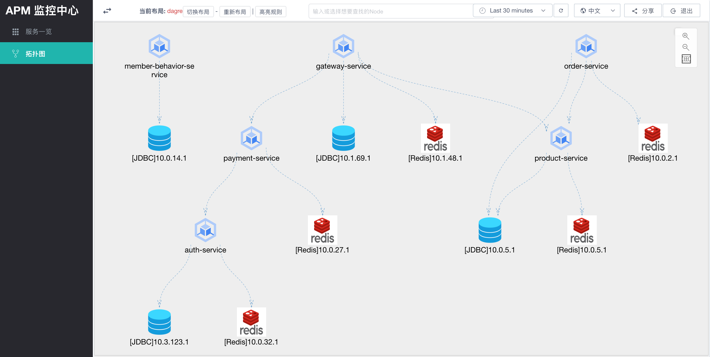
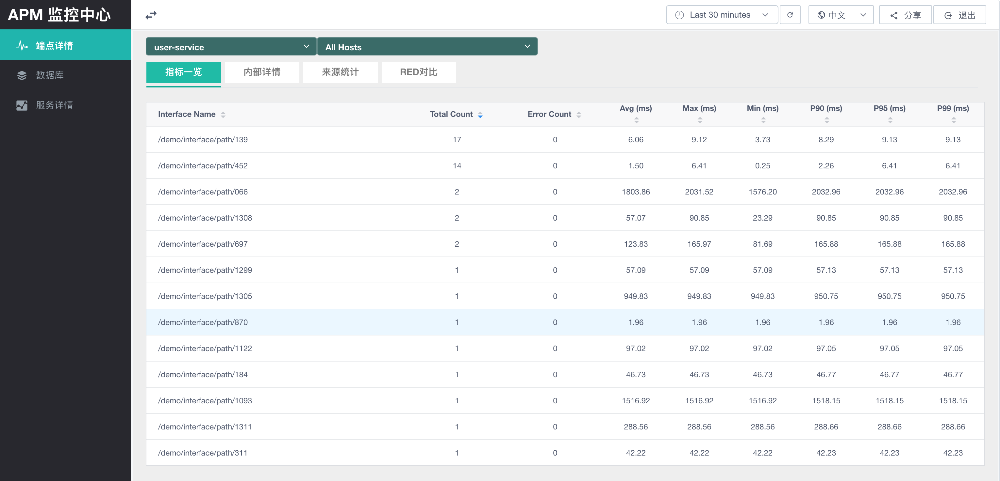

# 快速开始


本指南说明如何使用 `prism-explorer` 在本地快速体验 Prism APM。

`prism-explorer` 会通过 Docker Compose 启动一套演示环境，包括：

- Prism Explorer
- Prism APM UI Server
- Prism APM UI
- TimescaleDB

启动完成后，可以直接打开页面查看 UI，并生成模拟观测数据体验服务概览、拓扑和端点详情等功能。

## 开始前确认

当前启动脚本会在本机完成 Java 模块和前端资源构建，然后再启动 Docker Compose，因此本地需要安装：

| 工具             | 最低版本             | 说明                                                                |
| -------------- | ---------------- | ----------------------------------------------------------------- |
| Docker Desktop | 4.0 或更新版本        | 需要支持 `docker compose` v2 命令。                                      |
| JDK            | 21               | 后端模块使用 Java 21 编译和运行。                                             |
| Maven Wrapper  | 由 `./mvnw` 管理的 Maven 3.9.9 | 用于构建 `prism-explorer`、`prism-apm-common` 和 `prism-apm-ui-server`，不要求本机预先安装 Maven。 |
| Node.js        | 支持 22.12.0 或更新版本 | 版本要求来自 `prism-apm-ui/package.json` 的 `engines.node`。              |
| npm            | 10 或更新版本         | 通常随 Node.js 一起安装，用于安装前端依赖并执行构建。                                   |

## 克隆代码

```bash
git clone https://github.com/prism-apm/prism-apm.git
cd prism-apm
```

## 一键启动

### macOS / Linux

```bash
cd prism-explorer
./build-and-up.sh
```

### Windows PowerShell

以管理员身份打开 PowerShell，执行：

```powershell
cd prism-explorer
.\build-and-up.ps1
```

脚本会自动完成以下工作：

1. 清理旧的 Docker Compose 环境。
2. 构建 `prism-explorer`。
3. 构建 `prism-apm-common`。
4. 构建 `prism-apm-ui-server`。
5. 构建 `prism-apm-ui`。
6. 启动 Docker Compose 服务。

## 打开 Prism Explorer

启动完成后，在浏览器打开：

```text
http://localhost/
```

这里是 Prism Explorer 的入口页，可以进入模拟数据页面，也可以跳转到 Prism APM UI。



## 生成模拟数据

在 Prism Explorer 中进入 `Data Mock` 页面，选择日期范围，然后点击 `开始生成`。



如果想重新体验，也可以在该页面点击 `清空数据` 后重新生成。

## 查看 Prism APM UI

打开：

```text
http://localhost:8066/
```

进入 Prism APM UI 后，可以查看已经生成的模拟数据。

建议依次查看以下页面：

- 服务概览：确认服务指标已经展示。
- 拓扑图：查看服务、数据库、中间件之间的调用关系。
- 端点详情：查看单个服务的端点列表、调用次数、错误数和响应时间分位指标。







## 停止服务

体验结束后，可以停止本地演示环境：

```bash
cd prism-explorer
docker compose down
```

如果需要清理构建产生的镜像，可以执行：

```bash
docker image prune
```

## 常见问题

### 端口被占用

Prism Explorer 默认使用以下端口：

| 服务                        | 端口      |
| ------------------------- | ------- |
| Prism Explorer            | `80`    |
| Prism APM UI              | `8066`  |
| TimescaleDB               | `15432` |

如果本机已经有服务占用了这些端口，请先停止占用端口的服务，或者修改 `prism-explorer/docker-compose.yml` 中的端口映射。

### 页面打开后没有数据

可以按以下顺序检查：

1. 确认 `docker compose ps` 中服务都已启动。
2. 打开 `http://localhost/`，进入 `Data Mock` 页面。
3. 点击 `开始生成`，等待任务完成。
4. 刷新 `http://localhost:8066/`。

### 构建失败

当前脚本依赖本机的 JDK、Node.js、npm、Docker 和仓库中的 Maven Wrapper。请先确认这些命令可以正常执行，并满足“开始前确认”中的最低版本要求：

```bash
java -version
./mvnw -version
node -v
npm -v
docker version
```

## 下一步


完成本地体验后，可以继续阅读：

- Feature 文档：了解如何接入真实 OpenTelemetry Trace 数据。
- 部署文档：了解如何部署完整环境。
- 配置文档：了解 TimescaleDB、UI Server 和前端配置。
